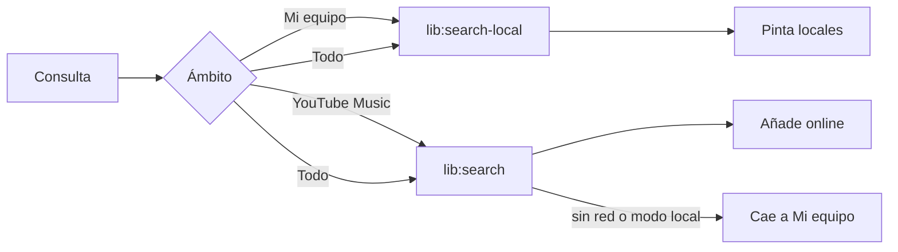

# Design · 2026-11-03-modo-local-y-buscador

## Enfoque

1. **Índice local en main** (`main/local-search.js`, clase `LocalSearch`). Se construye perezosamente a partir de cuatro fuentes y se invalida al llegar eventos (`local:event` hecho, análisis terminado, playlists importadas, géneros): música local (`localLib.list`), análisis guardados (`analyzer.list`: título, artista, BPM, Camelot, guardada), pistas de playlists importadas (`playlists.json`) y géneros (`genres.all`). Cada entrada guarda un texto normalizado (sin tildes ni mayúsculas) de título + artista + álbum + géneros; buscar es exigir que cada palabra de la consulta esté contenida (`every`), igual que la búsqueda de Ajustes. Con 20 000 pistas es un recorrido lineal de cadenas cortas (≈ 5 ms); la prueba lo exige por debajo de 100 ms.
2. **Una pista, una fila**: si una misma `videoId` sale de varias fuentes se fusiona (gana el dato más rico) y conserva la lista de fuentes (`sources: ['Mi equipo', 'Analizada', 'Importada: <lista>']`) para mostrarlas como etiquetas. Los resultados se identifican por id; el renderer nunca recibe rutas (`path` se quita antes de enviar) y la consulta no sale del proceso (REQ-8).
3. **Filtros**: `search(q, { bpm: [min, max], key, genres })` aplica después del texto; BPM por rango, tonalidad exacta o compatible (reutiliza `keysCompatible` de `renderer/camelot.js` movido a `shared/camelot.js` para usarlo en main).
4. **Ámbito del buscador**: `Todo | Mi equipo | YouTube Music`, en `localStorage` `alyssdj.search.scope`. «Todo» pinta de inmediato los locales y, si hay red, añade los de YouTube Music cuando llegan (sin repetir ids); «Mi equipo» no toca la red; «YouTube Music» es el comportamiento actual. Sin conexión (`navigator.onLine` falso o error de red) el ámbito efectivo pasa a «Mi equipo» con el mensaje «Sin conexión: mostrando tu equipo».
5. **Modo local** (ajuste `localMode`, por defecto apagado). `main/net-gate.js` exporta `offline()` (`settings.localMode`) y `guard(fn)`: los manejadores `lib:*`, la sesión de YouTube Music, `update:*`/`updater`, `ensureTools` y la descarga de modelos de stems devuelven `{ ok: false, error: 'Modo local: sin red' }` sin hacer ninguna petición. El renderer muestra la marca «LOCAL» en la barra superior (`#local-badge`) y fuerza el ámbito «Mi equipo».
6. **AutoMix local**: `radioCandidates` consulta `ytdj.local.similar(seed)` cuando el modo local está activo o el ámbito es «Mi equipo»; main devuelve pistas analizadas con BPM y tonalidad compatibles, ordenadas por `rankCandidates` igual que las de la radio. Sin esas pistas, la nota dice «Analiza más música local para sugerir».

## Contratos

IPC nuevo (`preload/app.js`):

```
lib:search-local  { q, scope?, bpm?: [min,max], key?, genres?: string[], limit?: 200 } → { ok, data: Row[], total, ms }
  Row = { videoId, title, artist, album, duration, thumb, local, bpm?, camelot?, genres?, sources: string[] }   // sin `path`
local:similar     { videoId, limit?: 10 } → { ok, data: Row[] }
net:state         → { localMode: boolean }          // y evento net:event { localMode }
```

`settings.localMode: boolean`, `localStorage alyssdj.search.scope ∈ all|local|online`. Mensajes: «Sin conexión: mostrando tu equipo», «Modo local: sin red».



## Visual Spec

Lectura: consola de DJ, modo Operate, densidad alta, tokens y superficies de `styles.css` sin cambios.
- Buscador: a su izquierda un `seg` de 3 opciones (Todo · Mi equipo · YouTube Music, 28 px) con la elegida resaltada; el placeholder cambia con el ámbito («Buscar en tu equipo…»).
- Cada fila lleva etiquetas de fuente discretas (Mi equipo · Analizada · Importada) junto al título; los de YouTube Music, sin etiqueta.
- Filtros (solo con resultados locales o la pestaña de local): BPM mín–máx (dos campos numéricos de 56 px), tonalidad Camelot (select) y Géneros (el menú existente), en una fila bajo el buscador; se vacían con «Limpiar».
- Marca «LOCAL» en la barra superior, zona de sistema, con punto de color de estado `--warn` y ayuda «Modo local: la app no usa la red».
- Estados: buscando · resultados · sin resultados («Nada coincide en tu equipo») · sin conexión («Sin conexión: mostrando tu equipo») · modo local («Modo local: solo tu equipo»).
- Teclado: `/` o `Ctrl+F` enfocan el buscador (ya existe); el selector de ámbito se recorre con flechas.
- Responsive: a 1280×720 los filtros caben en una línea; debajo de 1100 px se pliegan bajo un botón «Filtros».

## Amendments


## Domain deltas
### library
#### ADDED spec: Buscar en todo lo local
WHEN el usuario busca con el ámbito «Mi equipo» o «Todo» THE SYSTEM SHALL consultar un índice local (archivos, pistas guardadas, analizadas y de listas) sin tildes ni mayúsculas por título, artista, álbum y género, sin exponer la ruta de los archivos, y filtrar por BPM, tonalidad y compatibilidad con la pista cargada; WHILE no hay conexión THE SYSTEM SHALL mostrar los resultados locales con un aviso en lugar de un error.
#### ADDED design: Índice local
`main/local-search.js` (`LocalSearch`, `collect`, `keysCompatible`) se reconstruye de forma perezosa cuando cambian los archivos locales, los géneros, los análisis o las listas; IPC `lib:search-local` y `local:similar`; la UI lo usa desde `Library.runSearch` con el ámbito guardado en `localStorage alyssdj.search.scope`.
### sources
#### ADDED spec: Modo local sin red
WHILE el modo local está activo THE SYSTEM SHALL bloquear toda salida a la red (búsqueda y radios en línea, descarga de herramientas y modelos, actualizaciones, análisis que requiere descargar audio y peticiones de las ventanas web) con el mensaje «Modo local: sin red», dejar intacto todo lo que ya está en el equipo y mostrar la insignia «Modo local».
#### ADDED design: Compuerta de red
`main/net-gate.js` (`createGate`: `offline`, `assert`, `wrap`, `allowUrl`) envuelve los manejadores `lib:*`, el actualizador, el analizador, la descarga del modelo de stems y `webRequest.onBeforeRequest` de las sesiones; el ajuste `localMode` emite `net:event` al cambiar.
### ui
#### ADDED spec: Ámbito y filtros del buscador
THE SYSTEM SHALL ofrecer en el buscador el ámbito Todo, Mi equipo o YouTube Music (recordado entre sesiones) y, en la librería, filtros de BPM, tonalidad y compatibles con un botón para limpiarlos.
#### ADDED spec: AutoMix con la música del equipo
WHILE el modo local está activo o el ámbito es «Mi equipo» THE SYSTEM SHALL armar la cola de AutoMix con las pistas analizadas del equipo más compatibles (`local.similar`) sin consultar la radio de YouTube Music; IF no hay candidatas THEN THE SYSTEM SHALL avisar «Analiza más música de tu equipo para sugerir pistas».
