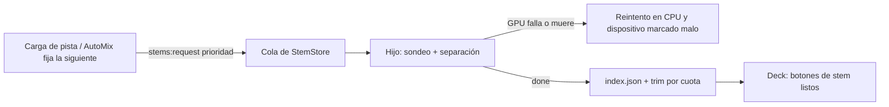

# Design · 2026-11-03-stems-gpu-automaticos

## Hallazgos del spike (2026-11-03, RTX 3090, Linux, `onnxruntime-node` 1.31.1)

| Prueba | Resultado |
|---|---|
| CPU, una ventana de 7,8 s (`htdemucs.ort` actual) | 2,8–3,7 s por ventana (con solape del 50 % ≈ 1,3× tiempo real) |
| `webgpu` en `onnxruntime-node` (Linux) | La sesión se crea (Vulkan funciona) pero `run` falla en `node_Softmax_1313`: «All inputs must be tensors on WebGPU buffers». Con `forceCpuNodeNames` el proceso se cuelga con *core dump* |
| `webgpu` en `onnxruntime-web` 1.22 dentro de Electron 45 | Adaptador `nvidia ampere` disponible; mismo fallo en el mismo nodo («no GPU data for input») |
| `cuda` en `onnxruntime-node` (Linux) | Falta `libonnxruntime_providers_shared.so`: el paquete no trae CUDA (se descarga aparte, ~1 GB, y exige CUDA 12 + cuDNN 9; aquí no hay cuDNN) |
| Windows x64 / macOS arm64 | El paquete ya trae `DirectML.dll` y CoreML; no se ha podido probar aquí |
| Repositorio del modelo (`gridshiftstudio/htdemucs-ort`) | Solo publica `htdemucs.ort` (formato ORT ya optimizado para CPU, con operadores fusionados): ese es el origen probable del fallo en GPU |

Conclusión: **no basta con cambiar el proveedor**. Para GPU hace falta un modelo ONNX sin optimizar para CPU (o una versión del `.ort` hecha para GPU), y hay que aislar los cuelgues del controlador. La tarea 1.1 resuelve el modelo antes de construir nada más.

## Enfoque

1. **Dispositivo por plataforma, con prueba**: `main/stems-device.js` devuelve la lista de proveedores a intentar: Windows → `dml`; macOS arm64 → `coreml`; Linux → `cuda` si están las bibliotecas, si no `webgpu`; siempre `cpu` al final. Tras elegir uno, el hijo ejecuta un **sondeo** (una ventana de audio sintético fija) y lo compara con la salida de CPU de referencia (SNR ≥ 40 dB) y mide el tiempo. Si el sondeo falla, tarda más que CPU, o el hijo muere, se marca el dispositivo como malo en `userData/stems/device.json` y se usa CPU. El sondeo se repite solo si cambia la versión de la app, del modelo o del controlador.
2. **Modelo por variante**: `MODEL` pasa a `MODELS = { cpu, gpu }`. `ModelManager` descarga la variante que toque con el mismo flujo de permiso, SHA-256 y `.part` (REQ-8); la de GPU solo se pide cuando hay GPU utilizable.
3. **Aislamiento**: la separación sigue en un proceso hijo (ya existente): un cuelgue o *core dump* del controlador de GPU solo mata ese proceso, que `StemStore` trata como error de dispositivo y reintenta en CPU.
4. **Preparación automática**: nuevo ajuste `stemsAuto` (`auto` | `on` | `off`, por defecto `auto` = activado solo con dispositivo distinto de CPU). El renderer pide separar al cargar una pista local en un deck y cuando AutoMix fija la siguiente pista. La cola de `StemStore` pasa a tener prioridad: 0 = pista de un deck, 1 = siguiente de AutoMix, 2 = el resto (manual desde la librería); una petición de menor número adelanta a las demás.
5. **Cuota**: `index.json` guarda `used` (última vez cargada). `StemStore.trim(limitBytes, keep)` borra primero los menos usados, nunca los cargados en decks (`keep`); se llama tras cada separación y al cambiar el límite (por defecto 5 GB).
6. **Deck sin «Activar»**: los cuatro botones de stem se muestran siempre que la pista tenga stems o se estén preparando (en ese caso desactivados con el avance). Pulsar uno con los stems listos pero sin activar ejecuta `stemsOn` y aplica el silencio/solo pedido en una sola acción; «Completa» vuelve a la pista entera. Si se pulsa mientras se preparan, la acción queda pendiente y se aplica al terminar.
7. **Cambio sin salto**: `stemsOn` carga el FLAC de 8 canales en un segundo `<audio>`, espera `canplaythrough`, lo coloca en `currentTime + latencia medida` del elemento original y hace un fundido cruzado de 40 ms entre la cadena completa y la matriz de stems (el motor ya mezcla con `setTargetAtTime`). La vuelta a «Completa» hace lo inverso.

## Contratos

IPC nuevo (`preload/app.js` → `ytdj.stems`):

```
stems:device      → { device: 'cpu'|'cuda'|'dml'|'coreml'|'webgpu', label: string, rt: number|null, probe: 'ok'|'fallo'|'pendiente' }
stems:settings    → { auto: 'auto'|'on'|'off', quotaGB: number, usedBytes: number }
stems:set         { auto?, quotaGB? } → settings
stems:request     { id, file, priority?: 0|1|2 }   (priority es nuevo; por defecto 2)
```

Evento `stems:event` añade `device` en `progress`/`done` y `etaS`; `done` incluye `rt` (segundos de audio / segundos de cálculo).

Mensaje al hijo: `start { …, provider: 'cpu'|'cuda'|'dml'|'coreml'|'webgpu', probe?: true }`; respuesta `{ type: 'probe', ok, rt, snr }` antes de empezar la pista.

Estado en disco: `userData/stems/device.json` `{ device, probedAt, appVersion, modelSha, ok, rt }`.



## Visual Spec

Lectura: consola de DJ para una persona que mezcla en directo, modo Operate, densidad alta.
- Tira STEMS del deck: los 4 botones siempre en su sitio (Voz, Batería, Bajo, Resto); sin stems, atenuados con el motivo en la ayuda; preparando, una barra fina de progreso bajo la tira y «Preparando · 40 s» en el mensaje; listos, normales.
- Desaparece el botón «Activar»; «Completa» solo se ve con algún stem silenciado.
- Ajustes → Stems: línea «Dispositivo: NVIDIA RTX 3090 (CUDA) · 14× tiempo real», interruptor «Preparar stems solos», control de cuota en GB, «Borrar todos» con el espacio usado.
- Estados: preparando · listo · fallo en GPU («Se usó la CPU: …») · sin motor.
- Movimiento: ninguno nuevo; la barra respeta `prefers-reduced-motion`.

## Amendments

### A1 · 2026-11-03
El spike (`spike-gpu.md`) halló un ONNX apto para GPU con otra interfaz: `StemSplitio/htdemucs-onnx` (MIT, 316 MB, entrada `mix`, salida `stems`, STFT/iSTFT dentro del grafo). En WebGPU corre ≈ 15× tiempo real frente a ≈ 3× en CPU, con SNR ≥ 67 dB. Por tanto la variante `gpu` no usa `shared/stems-dsp.js` y el hijo le pasa la ventana directa; la variante `cpu` sigue con el `.ort`. Afecta a REQ-1, REQ-2 y REQ-8.

## Domain deltas
### audio
#### ADDED spec: Stems en GPU con caída a CPU
WHEN hay un proveedor de GPU candidato en la plataforma (DirectML en Windows, CoreML en macOS arm64, CUDA o WebGPU en Linux) THE SYSTEM SHALL sondear una ventana sintética en ese proveedor y en CPU y usar la GPU solo si su salida coincide (SNR ≥ 40 dB) y es más rápida; IF el proveedor falla o su proceso muere THEN THE SYSTEM SHALL repetir la pista en CPU, marcar el dispositivo como malo hasta que cambie la versión de la app o del modelo e informar.
#### ADDED spec: Cambio sin salto a los stems
WHEN el usuario pulsa un stem de una pista con stems listos THE SYSTEM SHALL activarlos con el silencio o solo ya aplicado en una sola acción, con un fundido cruzado lineal de 40 ms desde la pista completa; WHEN no queda ningún stem silenciado o aislado THE SYSTEM SHALL volver a la pista completa con el mismo fundido.
#### ADDED design: Variantes de modelo y proceso hijo
`main/stems-device.js` (`DeviceSelector`, `candidates`, `hasCuda`) decide y recuerda el dispositivo en `userData/stems/device.json`; `main/stems.js` define `MODELS = { cpu, gpu }` y `ModelSet`; la variante `gpu` (`mix` → `stems`, STFT dentro del grafo) se separa con `separate(..., { direct: true })`; el sondeo y la separación corren en `main/stems-worker.js` (mensajes `probe` y `start` con `provider` y `variant`).
### library
#### ADDED spec: Preparación automática y cuota de stems
WHEN el ajuste de preparación es automático y la GPU está comprobada, o es «Siempre» THE SYSTEM SHALL separar la pista cargada en un deck (prioridad 0) y la siguiente de AutoMix (prioridad 1) antes que las peticiones manuales (prioridad 2); WHILE los stems superen la cuota (5 GB por defecto) THE SYSTEM SHALL borrar primero los menos usados, sin tocar los cargados en un deck ni el recién hecho.
### platform
#### ADDED spec: Descarga del modelo de GPU con permiso
WHEN hace falta el modelo de GPU THE SYSTEM SHALL pedir permiso mostrando nombre, origen, tamaño y licencia, descargarlo a un archivo parcial, verificar su SHA-256 y descartarlo si no coincide; IF el usuario no lo autoriza THEN THE SYSTEM SHALL seguir en CPU sin volver a preguntar en esa sesión.
