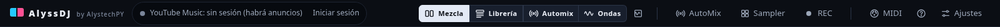
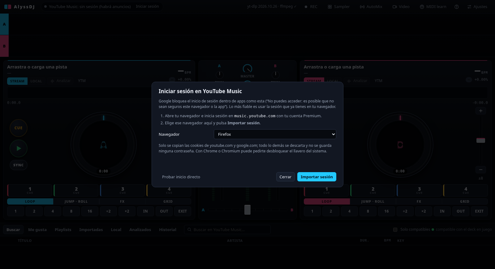
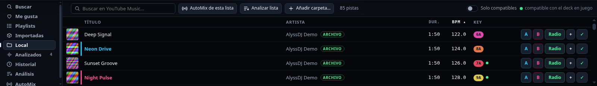

# 1. Primeros pasos

## Instalar y abrir

```bash
npm install
npm start
```

`npm install` y cada `npm start` comprueban solos lo que falta y lo descargan: **yt-dlp** (binario oficial, a `bin/`) y, si no hay, **ffmpeg**. La app lo repite al abrirse. Si algo no se pudo instalar, aparece en amarillo en la barra superior, y **Ajustes → Instalar / actualizar herramientas** lo reintenta.



Cuatro grupos, de izquierda a derecha: **identidad y sesión** (estado de YouTube Music), el **selector de vista** (Mezcla, Librería, Automix, Ondas; ver [Decks y mezclador](02-decks-y-mezclador.md)), **herramientas de la mezcla** (**AutoMix**, **Sampler**, **REC**) y **sistema** (**MIDI** para MIDI learn, **ayuda (?)** y **Ajustes**). Si falta yt-dlp o ffmpeg, se avisa en amarillo entre los dos primeros grupos; el detalle está en **Ajustes → Herramientas**.

## Iniciar sesión (YouTube Music Premium)

Google **bloquea el inicio de sesión dentro de apps como esta** ("No puedes acceder: es posible que no sean seguros este navegador o la app"). Por eso AlyssDJ usa la sesión que ya tienes en tu navegador:

1. En tu navegador (Firefox, Chrome, Chromium, Brave, Edge, Vivaldi u Opera), entra en `music.youtube.com` con tu cuenta Premium.
2. En AlyssDJ pulsa **Iniciar sesión**, elige ese navegador y pulsa **Importar sesión**.



- Se copian **solo** las cookies de youtube.com y google.com; el resto se descarta y no se guarda ninguna contraseña. El archivo temporal se borra siempre.
- Con **Chrome o Chromium** puede pedirte desbloquear el llavero del sistema; **Firefox** es el más sencillo.
- El punto verde indica sesión iniciada. Con Premium no verás anuncios; si ves "anuncio" en un deck, esa cuenta no tiene Premium activo.
- **Probar inicio directo** abre la ventana de Google con otra huella; Google puede seguir bloqueándola, y entonces usa la importación.
- Si el navegador cierra sesión o caduca, vuelve a importar. **Ajustes → Cerrar sesión** borra la sesión de la app.

Sin sesión todo funciona, pero YouTube mete anuncios y tus playlists no aparecen.

## Cargar música

Hay tres formas de tener pistas en un deck:

- **Buscar en YouTube Music** (fuente *Buscar*), o tus *Me gusta* y *Playlists*.
- **Música local**: fuente *Local* → **Añadir carpeta…**, o arrastra archivos de audio a un deck.
- **Importadas**: tus playlists copiadas al equipo.

En cada fila de la librería: **A** y **B** cargan en ese deck, **Radio** arranca [AutoMix](04-automix.md) desde esa pista, **+** la añade a la cola y el último botón la analiza.



También puedes **arrastrar una fila a un deck** o hacer **doble clic** (va al deck que no está sonando).

## Tu primera mezcla

1. Carga una pista en **A** y dale **play** (▶ verde).
2. Carga otra en **B**. Si ambas tienen BPM (las locales siempre; las de YouTube tras *Analizar*), pulsa **SYNC** en B: iguala el tempo y la fase.
3. Con **CUE** o un **hot cue** deja B lista, dale play y mueve el **crossfader** de A a B.
4. Baja los graves (**LOW**) de la pista que sale mientras entras con los de la nueva: es el "bass swap".


Siguiente: [Decks y mezclador](02-decks-y-mezclador.md).
