# 2. Decks y mezclador

## Un deck

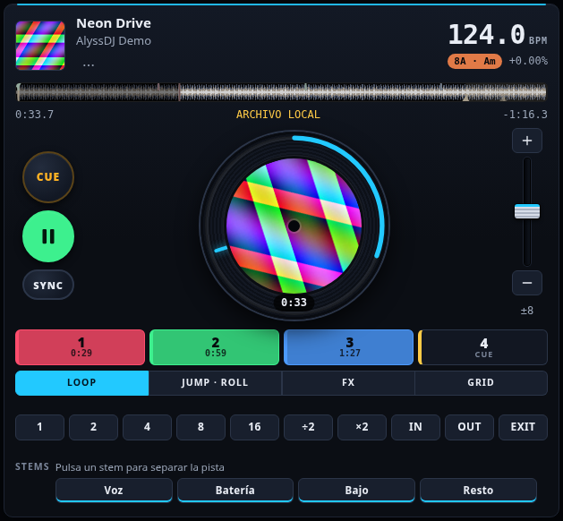

| Zona | Qué hace |
|---|---|
| **Cabecera** | Título y artista; la etiqueta de **origen** (ARCHIVO LOCAL, GUARDADA o STREAM) y el selector **STREAM / ARCHIVO**; **Analizar**; BPM actual, tonalidad (con el color de la rueda Camelot) y desvío de pitch |
| **Vista general** | Toda la pista. Clic para saltar |
| **Plato** | La portada gira con la pista y el anillo marca el progreso. Arrastra en círculo: sonando = *bend*, en pausa = búsqueda fina. |
| **CUE / ▶ / SYNC** | Transporte (ver abajo) |
| **Pitch** | Fader vertical, **+ / −** de nudge y el rango (±6, 8, 16, 50) |
| **Hot cues 1–4** | Clic para fijar; clic de nuevo para saltar. **Shift** + clic (o clic derecho) los borra. Se guardan por pista |
| **Banco** | Pestañas **LOOP · JUMP/ROLL · FX · GRID** |

### Transporte

- **CUE**: sonando, vuelve al punto de cue y pausa. En pausa sobre el cue, *mantenido* hace preview y al soltar vuelve. En pausa en otro punto, fija un nuevo cue.
- **▶**: play / pausa.
- **SYNC**: iguala el tempo con el otro deck y alinea la fase. Se mantiene el tempo igualado hasta que lo vuelves a pulsar o mueves el pitch.
- **KEY** (keylock): el tempo cambia sin cambiar el tono. **QUANT**: cues y loops caen en el beat.

## Formas de onda

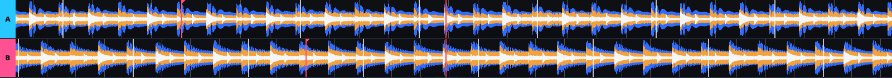

Arriba, una onda por deck con **tres bandas** (graves azules, medios naranjas, agudos blancos), la rejilla de beats (el compás en blanco) y tus cues. Con **Ctrl + rueda** haces zoom:

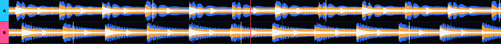

Sin analizar, la onda se dibuja *mientras suena*. Tras **Analizar** (YouTube) o al cargar una pista local, aparece completa.

## Loops

- **1 · 2 · 4 · 8 · 16**: loop automático de esa cantidad de beats desde el beat actual. Otro clic lo quita.
- **÷2 / ×2**: reduce o duplica el loop activo.
- **IN / OUT**: loop manual. **EXIT**: sale; si no hay loop, vuelve al último.

## Beat jump y loop roll

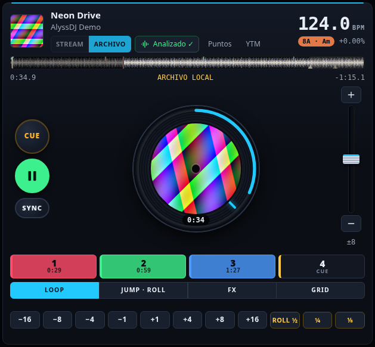

- **−16 … +16**: salta esa cantidad de beats.
- **ROLL ½ · ¼ · ⅛**: *mantén pulsado* para repetir ese trozo; al soltar, la pista continúa donde **habría estado** (efecto slip). Ideal para redobles al final de una frase.

Los dos necesitan BPM: pista analizada o **TAP**.

## Rejilla (GRID)

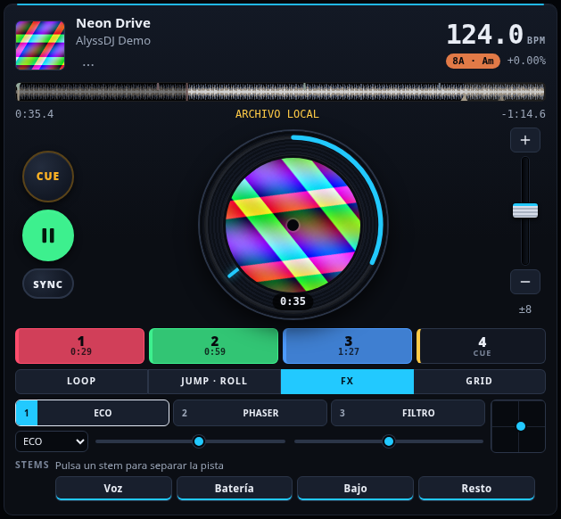

La rejilla se detecta sola. Si queda corrida:

- **◀ ▶** la mueven de 5 ms en 5 ms.
- **SET GRID** fija el beat 1 donde estás ahora (ponte sobre el golpe del bombo y púlsalo).
- **TAP** da un BPM aproximado a una pista sin analizar.

El ajuste se guarda por pista.

## Efectos

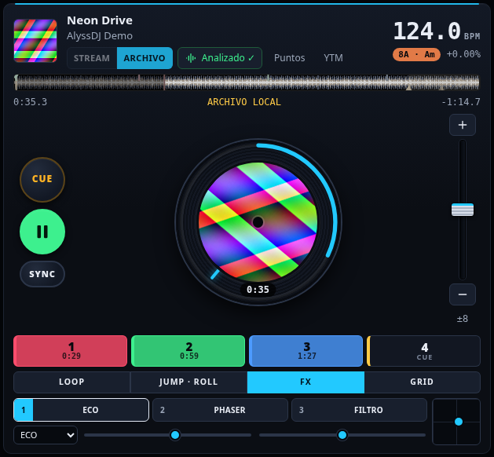

Cada deck tiene una **cadena de tres efectos en serie** (1 → 2 → 3). Pestaña **FX**:

1. Arriba, las **tres ranuras**: el número a la izquierda enciende o apaga el efecto; el nombre elige la ranura que editas (borde claro).
2. Debajo, para la ranura elegida: el **tipo**, la **cantidad** y **P**, un segundo parámetro que cambia según el tipo.
3. A la derecha, el **pad XY**: arrastra para mover a la vez la cantidad (izquierda → derecha) y P (abajo → arriba). Al pulsarlo la ranura se enciende; con **Mantener** (por defecto, en *Ajustes → Efectos y filtros*) se apaga al soltar, como un efecto instantáneo. Con el teclado: flechas (±0,02; **Mayús** ±0,1); doble clic lo centra.

| Tipo | Qué hace | P |
|---|---|---|
| **Eco** | Eco sincronizado al BPM | División: ¼, ½, ¾ o 1 beat (y la realimentación) |
| **Reverb** | Sala sintética | Tamaño: de sala pequeña a grande |
| **Flanger** | Barrido de peine | Velocidad, por beats (16 → 1) |
| **Gate** | Corta el audio al ritmo | Corte por beat (1, ½, ¼) |
| **Phaser** | Muescas que se mueven | Velocidad, por beats (16 → 1) |
| **Crush** | Reduce los bits (12 → 3) | Bits |
| **Filtro** | Pasa-bajos resonante | Frecuencia de corte |

Puedes repetir el mismo tipo en varias ranuras. Con una ranura apagada o con cantidad 0 el audio pasa intacto y no gasta procesador. Los efectos sincronizados siguen al tempo aunque muevas el pitch. La cadena de cada deck se recuerda entre sesiones (se puede apagar en Ajustes) y cargar otra pista no la cambia.

Todos los controles se pueden asignar por **MIDI learn** (interruptor, cantidad y P de cada ranura). En compactos de pantalla muy pequeña el banco FX queda oculto, igual que los demás bancos.

## Mezclador

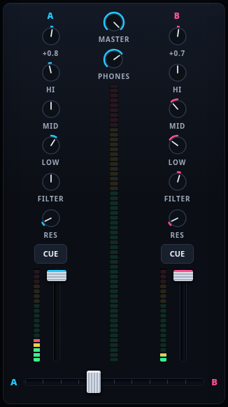

Por canal, de arriba abajo: **TRIM** (ganancia; se ajusta solo al cargar una pista analizada), **HI · MID · LOW** (EQ de 3 bandas; todo a la izquierda es *kill*), **FILTER** (a la izquierda pasa-bajos, a la derecha pasa-altos), **RES** (resonancia del filtro; su valor por defecto se cambia en *Ajustes → Efectos y filtros*, y el doble clic vuelve a él), **CUE** (PFL: escuchar en los auriculares), el **fader** con su medidor de nivel y el **crossfader** de abajo.

En el centro: **MASTER** y **PHONES** (volumen de auriculares).

- **Doble clic** en un knob, en el fader de pitch o en el crossfader lo restablece.
- **Mayús** mientras arrastras un knob da ajuste fino.
- La curva del crossfader (suave o corte) se cambia en **Ajustes → Decks**.

### Auriculares

En **Ajustes → Audio** elige *Dos dispositivos* (master y auriculares por separado) o *Un dispositivo de 4 canales* (1-2 master, 3-4 cue, típico de controladoras DJ).

## De dónde suena cada pista

La fuente se decide sola al cargar la pista y se ve en la etiqueta del deck y en el chip de cada fila de la librería:

- **ARCHIVO LOCAL**: un archivo de tus carpetas. Es siempre el archivo; no existe otra fuente.
- **GUARDADA**: una pista de YouTube de la que ya tienes copia (la guardó el análisis). Suena desde el archivo, sin anuncios, si **Ajustes → Librería y música → Preferir la copia guardada** está activo (lo está por defecto).
- **STREAM**: suena desde YouTube Music con tu sesión.

El selector **STREAM / ARCHIVO** del deck solo se puede usar cuando existen las dos opciones (una pista guardada); si no, aparece atenuado y al pasar el ratón dice por qué («Analiza la pista para tener archivo»). Si la copia guardada se borró, la pista suena por streaming y la app lo avisa una vez.

## Vistas de trabajo

Arriba, junto a las herramientas, el selector de vista (también **Alt+1 … Alt+4**):

| Vista | Para qué |
|---|---|
| **Mezcla** (Alt+1) | La consola completa: ondas, decks, mezclador y la librería debajo |
| **Librería** (Alt+2) | Decks compactos y la librería con casi toda la altura, para preparar y buscar |
| **Automix** (Alt+3) | Portada grande de lo que suena, la siguiente pista, la barra de la transición y los controles de AutoMix |
| **Ondas** (Alt+4) | Ondas grandes y una tira por deck con play, cue y sync, más el mezclador; sin librería |

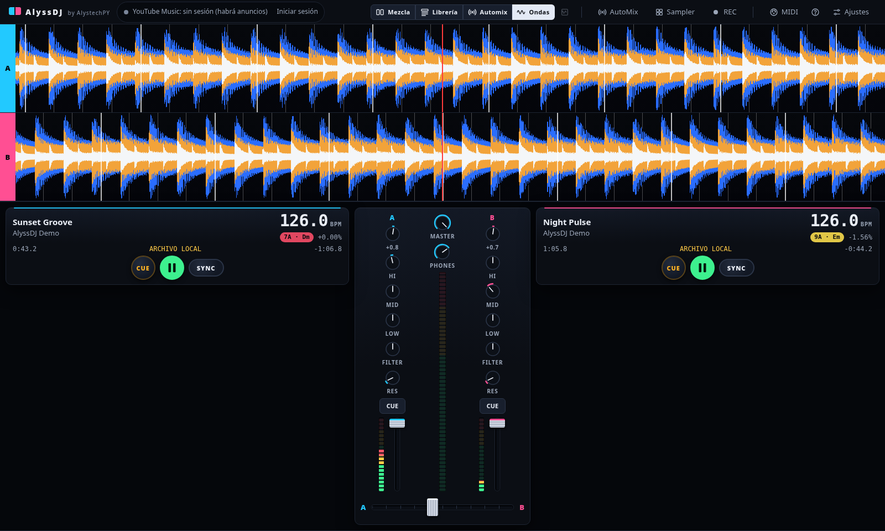

El botón junto al selector (o **Ajustes → General → Ondas grandes**) elige dónde van las ondas con desplazamiento en las vistas Mezcla y Librería: **arriba**, a todo el ancho, o **dentro de cada deck**, encima de su vista general; así la franja superior libera su altura.

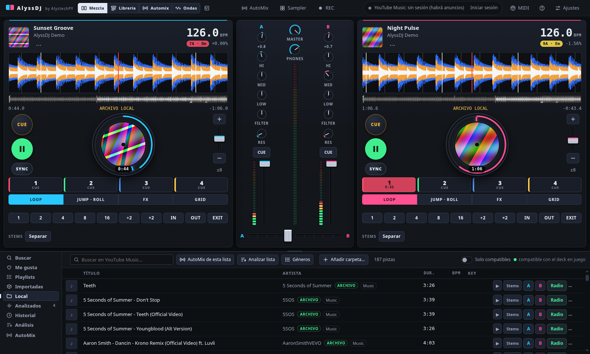

### Cambiar el tamaño de las zonas

En **Mezcla** y **Librería** hay un divisor bajo las ondas y otro sobre la librería. Arrástralos para dar más o menos altura a las ondas o a la librería; **doble clic** restablece la vista. Con el teclado: enfoca el divisor y usa **↑ / ↓** (8 px; **Mayús** 32 px). Cada vista recuerda su tamaño, y *Ajustes → General → Restablecer vistas* los devuelve a todos al original. Manda el último divisor que muevas: el otro cede el espacio sobrante. Los decks y el mezclador mantienen su alto, y cada zona deja a la otra un mínimo (ondas 90 px, librería 150 px).

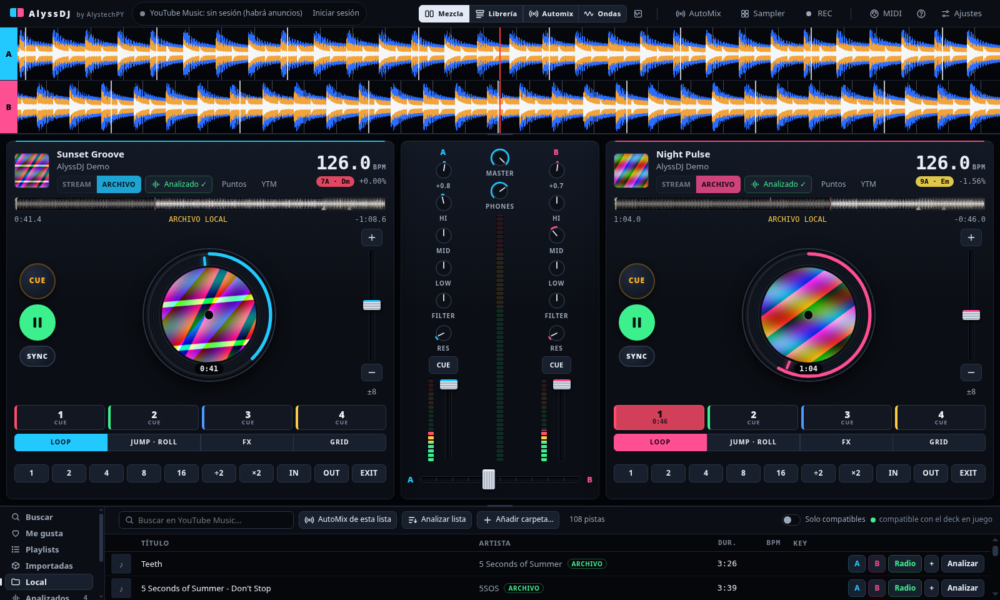

La vista y la opción de ondas se recuerdan entre sesiones. Al abrir la fuente **AutoMix** de la librería se pasa a la vista Librería y, al salir, vuelve la anterior (salvo que hayas elegido otra mientras tanto).

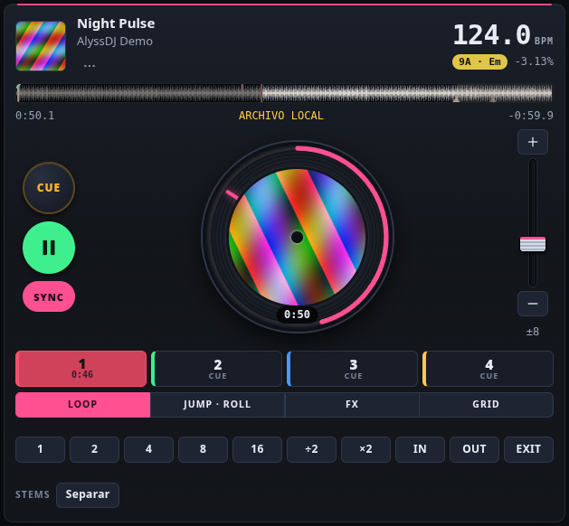
