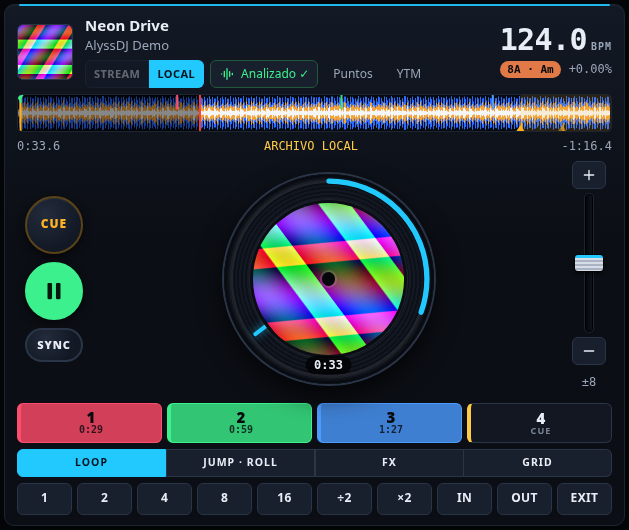
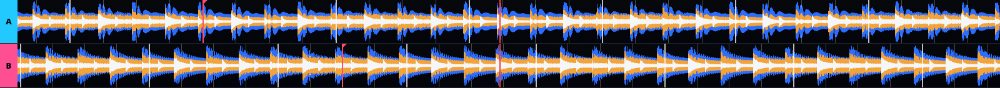
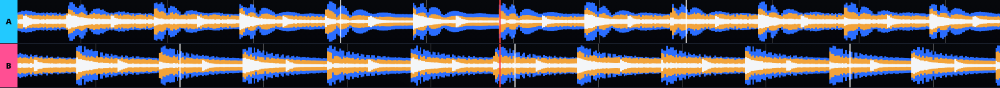
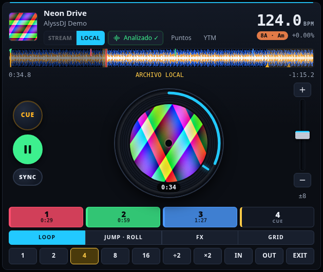
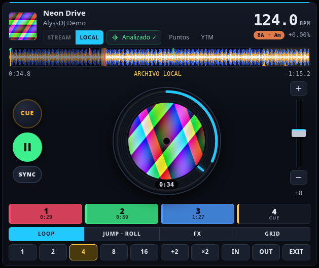
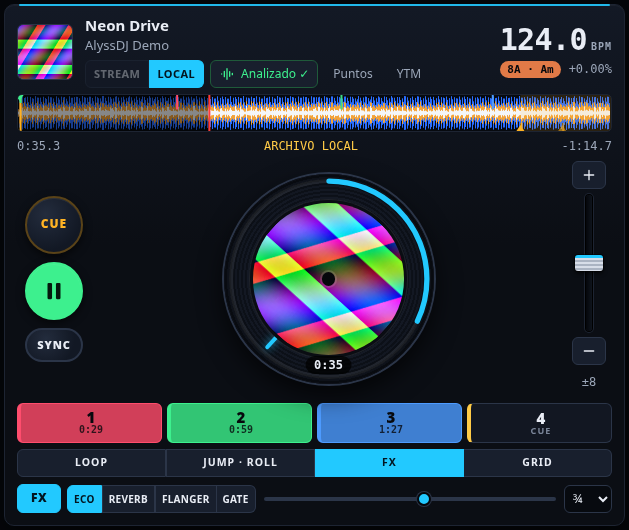
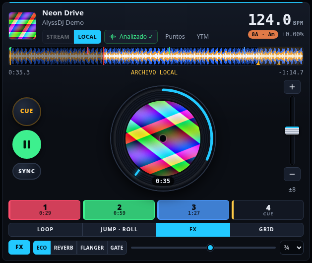
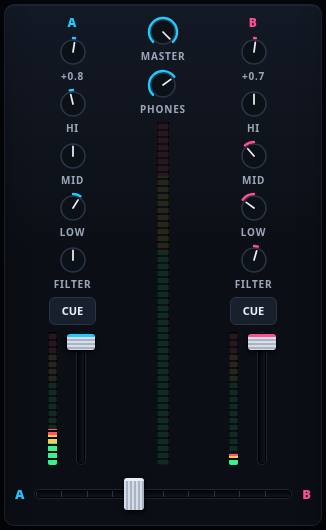
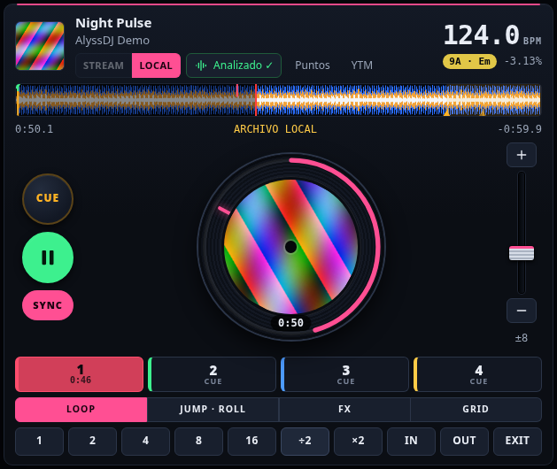

# 2. Decks y mezclador

## Un deck

| Zona | Qué hace |
|---|---|
| **Cabecera** | Título y artista; **STREAM / LOCAL** (de dónde suena); **Analizar**; BPM actual, tonalidad (con el color de la rueda Camelot) y desvío de pitch |
| **Vista general** | Toda la pista. Clic para saltar |
| **Plato** | La portada gira con la pista y el anillo marca el progreso. Arrastra en círculo: sonando = *bend*, en pausa = búsqueda fina. Doble clic abre la [ventana de video](05-video-y-segunda-pantalla.md) |
| **CUE / ▶ / SYNC** | Transporte (ver abajo) |
| **Pitch** | Fader vertical, **+ / −** de nudge y el rango (±6, 8, 16, 50) |
| **Hot cues 1–4** | Clic para fijar; clic de nuevo para saltar. **Shift** + clic (o clic derecho) los borra. Se guardan por pista |
| **Banco** | Pestañas **LOOP · JUMP/ROLL · FX · GRID** |

### Transporte

- **CUE**: sonando, vuelve al punto de cue y pausa. En pausa sobre el cue, *mantenido* hace preview y al soltar vuelve. En pausa en otro punto, fija un nuevo cue.
- **▶**: play / pausa.
- **SYNC**: iguala el tempo con el otro deck y alinea la fase. Se mantiene el tempo igualado hasta que lo vuelves a pulsar o mueves el pitch.
- **KEY** (keylock): el tempo cambia sin cambiar el tono. **QUANT**: cues y loops caen en el beat.

## Formas de onda

Arriba, una onda por deck con **tres bandas** (graves azules, medios naranjas, agudos blancos), la rejilla de beats (el compás en blanco) y tus cues. Con **Ctrl + rueda** haces zoom:

Sin analizar, la onda se dibuja *mientras suena*. Tras **Analizar** (YouTube) o al cargar una pista local, aparece completa.

## Loops

- **1 · 2 · 4 · 8 · 16**: loop automático de esa cantidad de beats desde el beat actual. Otro clic lo quita.
- **÷2 / ×2**: reduce o duplica el loop activo.
- **IN / OUT**: loop manual. **EXIT**: sale; si no hay loop, vuelve al último.

## Beat jump y loop roll

- **−16 … +16**: salta esa cantidad de beats.
- **ROLL ½ · ¼ · ⅛**: *mantén pulsado* para repetir ese trozo; al soltar, la pista continúa donde **habría estado** (efecto slip). Ideal para redobles al final de una frase.

Los dos necesitan BPM: pista analizada o **TAP**.

## Rejilla (GRID)

La rejilla se detecta sola. Si queda corrida:

- **◀ ▶** la mueven de 5 ms en 5 ms.
- **SET GRID** fija el beat 1 donde estás ahora (ponte sobre el golpe del bombo y púlsalo).
- **TAP** da un BPM aproximado a una pista sin analizar.

El ajuste se guarda por pista.

## Efectos

Cada deck tiene su unidad de efectos. Pestaña **FX**:

1. **FX** enciende o apaga.
2. Elige el tipo: **ECO** (sincronizado al BPM), **REVERB**, **FLANGER** o **GATE** (corta el audio a corcheas).
3. El deslizador es la cantidad. En el eco, el selector de la derecha es el tiempo (¼, ½, ¾ o 1 beat).

El eco sigue al tempo aunque muevas el pitch.

## Mezclador

Por canal, de arriba abajo: **TRIM** (ganancia; se ajusta solo al cargar una pista analizada), **HI · MID · LOW** (EQ de 3 bandas; todo a la izquierda es *kill*), **FILTER** (a la izquierda pasa-bajos, a la derecha pasa-altos), **CUE** (PFL: escuchar en los auriculares), el **fader** con su medidor de nivel y el **crossfader** de abajo.

En el centro: **MASTER** y **PHONES** (volumen de auriculares).

- **Doble clic** en un knob, en el fader de pitch o en el crossfader lo restablece.
- **Mayús** mientras arrastras un knob da ajuste fino.
- La curva del crossfader (suave o corte) se cambia en **Ajustes → Decks y diseño**.

### Auriculares

En **Ajustes → Audio** elige *Dos dispositivos* (master y auriculares por separado) o *Un dispositivo de 4 canales* (1-2 master, 3-4 cue, típico de controladoras DJ).

## Fuente: STREAM o LOCAL

- **STREAM**: suena desde YouTube Music con tu sesión.
- **LOCAL**: suena un archivo. Las pistas de tus carpetas son siempre locales. Una pista de YouTube pasa a LOCAL si activas *Conservar audio tras analizar* y la analizas.

