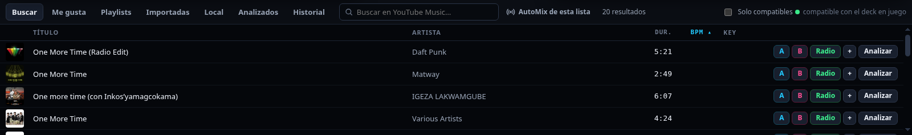
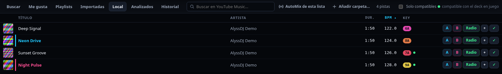

# 3. Librería y playlists

## Pestañas

| Pestaña | Contenido |
|---|---|
| **Buscar** | Búsqueda en YouTube Music (funciona sin sesión) |
| **Me gusta** | Tus canciones con "me gusta" |
| **Playlists** | Tus playlists de YouTube Music (con sesión). Clic en una la abre |
| **Importadas** | Playlists copiadas a este equipo; abren sin conexión |
| **Local** | Carpetas de tu disco (con etiquetas y carátulas) |
| **Analizados** | Pistas que ya analizaste |
| **Historial** | Lo que sonó más de 20 s |

## Importar tus playlists

1. Inicia sesión en YouTube Music.
2. Pestaña **Playlists** → **Importar mis playlists**.
3. Se copian todas tus listas y los Me gusta. Aparecen en **Importadas**.

Sirven sin conexión y como fuente de [AutoMix](04-automix.md) (**AutoMix de esta lista**).

> Importar necesita tu sesión; sin ella la lista de playlists sale vacía.

## Música local

- **Añadir carpeta…** (en la pestaña *Local* o en Ajustes) recorre la carpeta y sus subcarpetas. Formatos: mp3, flac, wav, m4a, aac, ogg, opus, aiff, wma.
- Se leen título, artista, duración y la **carátula incrustada**; si no tiene, se genera una.
- Las pistas locales **se analizan solas** al cargarlas (BPM, tonalidad, onda). No se descarga ni se toca nada.
- También puedes **arrastrar archivos** del explorador directo a un deck.

## Analizar pistas de YouTube

El botón **Analizar** (en el deck o en la fila) descarga el audio con yt-dlp, calcula BPM, rejilla, tonalidad y onda, y **borra el audio** (salvo que actives *Conservar audio*). Solo ocurre cuando lo pides, nunca solo.

## Orden y compatibles

- Clic en una cabecera (**Título, Artista, Dur., BPM, Key**) ordena; otro clic invierte. Lo que no tiene dato va al final.
- La **clave** se muestra con el color de la rueda Camelot. Un **punto verde** marca las pistas *compatibles* con el deck que suena: clave igual, ±1 en la rueda o su relativa, y BPM dentro de ±6 % (también a doble o mitad de tempo).
- **Solo compatibles** oculta el resto:

## Botones de cada fila

- **A / B**: cargar en ese deck.
- **Radio**: inicia AutoMix desde esa pista.
- **+**: añade a la cola de AutoMix.
- **Analizar / ✓**: analizar (✓ = ya analizada).
- Arrastrar la fila a un deck, o doble clic, también carga.
