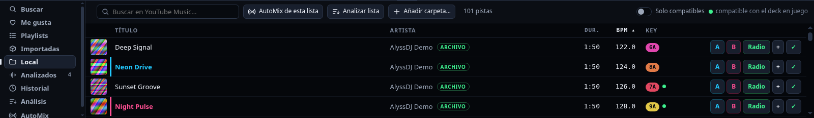
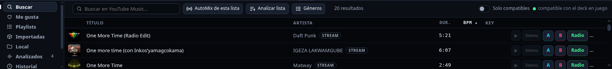
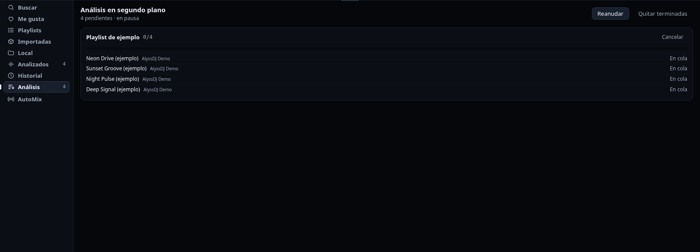
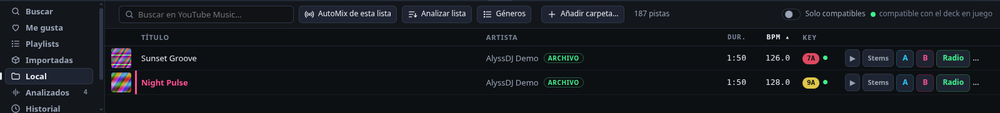
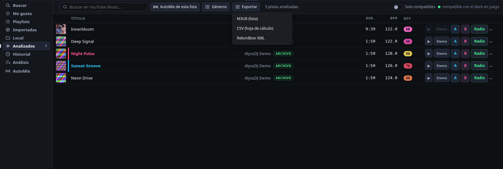

# 3. Librería y playlists

## Fuentes

A la izquierda de la librería hay un panel de fuentes (con ancho reducido, solo iconos); encima de la tabla están la búsqueda y las acciones de la fuente elegida.

| Fuente | Contenido |
|---|---|
| **Buscar** | Búsqueda en YouTube Music (funciona sin sesión) |
| **Me gusta** | Tus canciones con "me gusta" |
| **Playlists** | Tus playlists de YouTube Music (con sesión). Clic en una la abre |
| **Importadas** | Playlists copiadas a este equipo; abren sin conexión |
| **Local** | Carpetas de tu disco (con etiquetas y carátulas) |
| **Analizados** | Pistas que ya analizaste |
| **Historial** | Lo que sonó más de 20 s |
| **Análisis** | La cola de análisis en segundo plano (ver más abajo), con un contador de pendientes |
| **AutoMix** | La cola y los controles de la mezcla automática (ver [AutoMix](04-automix.md)) |

Cada fila lleva un chip de **origen** bajo el nombre del artista: **ARCHIVO** (archivo de tu disco o copia guardada) o **STREAM** (suena desde YouTube Music).

## Analizar listas enteras en segundo plano

- **Analizar lista** (barra de herramientas de la librería) encola todas las pistas de lo que estás viendo que aún no estén analizadas: una playlist abierta, Me gusta, una búsqueda, una carpeta local.
- En **Playlists** e **Importadas**, cada lista tiene su botón **Analizar** sin tener que abrirla; en Importadas se ve cuántas pistas de cada una ya están analizadas.
- La fuente **Análisis** muestra cada lista con su avance (hechas/total) y el estado de cada pista: en cola, descargando con porcentaje, analizando, hecha o error con su motivo. Puedes **pausar y reanudar** todo, **cancelar** una lista, **reintentar** las que fallaron y **quitar las terminadas**.
- Se analiza **de una en una** para no competir con lo que suena. Lo que pidas a mano pasa primero, y las pistas cargadas en un deck van antes que el resto. Un error no detiene la cola.
- La cola se **guarda en disco**: si cierras la app, sigue donde quedó al abrirla.
- Si YouTube pide comprobar que no eres un bot, la cola **espera** unos minutos y sigue sola.

## Importar tus playlists

1. Inicia sesión en YouTube Music.
2. Fuente **Playlists** → **Importar mis playlists**.
3. Se copian todas tus listas y los Me gusta. Aparecen en **Importadas**.

Sirven sin conexión y como fuente de [AutoMix](04-automix.md) (**AutoMix de esta lista**).

> Importar necesita tu sesión; sin ella la lista de playlists sale vacía.

## Mis listas (playlists locales)

Bajo las fuentes está **Mis listas**: playlists tuyas, guardadas en tu equipo (no en YouTube Music). Nunca tocan tus archivos de música.

- **Crear:** el botón **＋** crea «Nueva playlist» y te deja escribir el nombre ahí mismo (Intro guarda, Esc deja el nombre por defecto). La barra de la lista permite **Renombrar**, **Duplicar** y **Borrar**.
- **Poner pistas:** arrastra una o varias filas sobre una lista de las fuentes, o pulsa **＋** en la fila (o **Añadir a playlist ▾** con una selección) y elige la lista; «Nueva playlist…» crea una con esas pistas. Funciona desde cualquier fuente: búsqueda, Me gusta, importadas, locales, analizadas o historial. Una pista no se repite en la misma lista.
- **Sacar pistas:** selecciónalas dentro de la lista y pulsa **Quitar de la lista**. No se borra el archivo ni se quita de otras listas, y **Deshacer** (o Ctrl+Z) las devuelve a su sitio.
- **Selección múltiple:** clic selecciona, Ctrl/Cmd+clic suma, Mayús+clic elige un rango, Ctrl+A todo. Con dos o más aparece la barra de acciones: añadir a una lista, quitar, **A la cola de AutoMix** y **Analizar**.
- **Ordenar:** **Ordenar por…** (título, artista, BPM, tonalidad, género o duración) con el botón ↑/↓ para el sentido; las pistas sin dato van siempre al final. También puedes **arrastrar filas** para reordenarlas a mano. El orden queda guardado.
- **Listas inteligentes:** el botón del rayo crea una lista que se arma sola con filtros (BPM, tonalidad y compatibles, géneros, solo analizadas, solo con stems). Cambia sus filtros con **Filtros**; no se edita pista por pista.
- **Importadas:** en «Importadas», **Guardar como lista** (o **Guardar como lista local** dentro de una) copia una playlist de YouTube Music como lista editable. La original no cambia.
- **Salir a otros sitios:** cualquier lista se exporta con **Exportar** (M3U8, CSV, Rekordbox XML) y **AutoMix de esta lista** la manda a la cola.

Las listas se guardan en `userData/playlists-local.json` de forma atómica. Si el archivo se daña, se conserva una copia `.bad-…` y la app arranca sin listas en lugar de fallar.

## Música local

- **Añadir carpeta…** (en la fuente *Local* o en Ajustes) recorre la carpeta y sus subcarpetas. Formatos: mp3, flac, wav, m4a, aac, ogg, opus, aiff, wma.
- Se leen título, artista, duración y la **carátula incrustada**; si no tiene, se genera una.
- Las pistas locales **se analizan solas** al cargarlas (BPM, tonalidad, onda). No se descarga ni se toca nada.
- También puedes **arrastrar archivos** del explorador directo a un deck.

## Analizar y guardar pistas de YouTube

El botón **Analizar** (en el deck o en la fila) descarga el audio **sin sesión** con yt-dlp, calcula BPM, rejilla, tonalidad y onda, y **lo guarda en tu librería local**: `Música/AlyssDJ/YouTube`, en la mejor calidad que ofrece YouTube (sin convertir), con título, artista y carátula.

- Aparece en la fuente **Local** con su análisis ya hecho, y la fila de YouTube pasa a decir **Guardada**.
- Al cargar de nuevo esa pista, el deck **reproduce el archivo** (modo LOCAL, sin anuncios y sincronizable) y muestra **GUARDADA**. Puedes volver al stream con el botón **STREAM**.
- **Guardar lo que reproduzcas:** una pista que lleva **30 s sonando por streaming** se guarda y analiza en segundo plano, de a una, sin cortar la reproducción.
- En **Ajustes → Librería** puedes apagar cualquiera de las dos opciones, cambiar la carpeta de la librería o abrirla. Con ambas apagadas no se descarga nada salvo que pulses Analizar.

> yt-dlp va **sin tu sesión**: tus cookies se usan solo para el streaming. Así se evitan errores de "formato no disponible". Las pistas que exijan iniciar sesión (restricción de edad, privadas) no se pueden analizar; seguirán sonando por streaming.

## Orden y compatibles

- Clic en una cabecera (**Título, Artista, Dur., BPM, Key**) ordena; otro clic invierte. Lo que no tiene dato va al final.
- La **clave** se muestra con el color de la rueda Camelot. Un **punto verde** marca las pistas *compatibles* con el deck que suena: clave igual, ±1 en la rueda o su relativa, y BPM dentro de ±6 % (también a doble o mitad de tempo).
- **Solo compatibles** oculta el resto:

## Botones de cada fila

- **A / B**: cargar en ese deck.
- **Radio**: inicia AutoMix desde esa pista.
- **+**: añade a la cola de AutoMix.
- **Analizar / ✓**: analizar (✓ = ya analizada).
- Arrastrar la fila a un deck, o doble clic, también carga.

## Exportar a otro programa

En **Analizadas** y dentro de cualquier **playlist importada** aparece el botón **Exportar**. Elige el formato y dónde guardarlo:

- **M3U8 (lista)**: una lista que casi cualquier reproductor y programa de DJ entiende.
- **CSV (hoja de cálculo)**: título, artista, duración, BPM, tonalidad, Camelot, ruta e id, en UTF-8 con acentos (se abre bien en Excel y LibreOffice).
- **Rekordbox XML**: colección con BPM, tonalidad, rejilla de tempo y tres marcas por pista (**Mezcla**, **Intro** y **Salida**, sacadas del análisis); en Rekordbox, *Archivo → Importar* lo lee.

Solo se exportan con ruta de audio las pistas que están en tu disco (locales o **guardadas**). Las que solo existen por streaming no se pueden reproducir fuera de la app: M3U8 y Rekordbox las omiten (la app avisa cuántas) y el CSV las conserva con la ruta vacía. El archivo se escribe entero o no se escribe. Traktor no está incluido.

## Preescucha

El botón **▶** al principio de las acciones de cada pista la reproduce **por los auriculares** (la salida «Auriculares» de Ajustes; si no hay, por la salida por defecto) sin cargarla en ningún deck ni tocar el master.

- Empieza en el punto de entrada de mezcla de la pista (el editado, o el que marcó el análisis); sin análisis, al 25 % de su duración.
- Suena una sola a la vez: al pulsar ▶ en otra, o ■ en la misma, la anterior se para. También se para al terminar.
- Una barra bajo el título muestra el avance; pulsa sobre ella para saltar a otro punto.
- Solo funciona con pistas que existen como archivo en tu equipo. Las de streaming muestran ▶ deshabilitado: guárdalas (analízalas) para preescucharlas. No se descarga nada por su cuenta.
- Sin auriculares configurados, si un deck empieza a sonar la preescucha se para y la app te lo avisa, para que nunca se oiga encima de la mezcla.

## Géneros

Cada pista puede llevar hasta cinco **géneros** (etiquetas de texto libre). Se leen solos de las **etiquetas del archivo** (ID3/MP4) o de los metadatos al analizar, y puedes escribirlos tú:

- En la fila, el botón **♯** abre el editor: escribe un género y pulsa Enter o coma; Retroceso quita el último; Escape cierra. Lo que escribes a mano manda y no se pierde al reanalizar; dejar la lista vacía vuelve a lo automático.
- Los géneros salen como chips junto al artista (hasta tres y «+N») y también en la cola del AutoMix.
- El botón **Géneros** de la barra abre un **filtro** con casillas y cuántas pistas tiene cada género; sirve para ver solo lo que mezcla bien entre sí.
- El **AutoMix** prefiere, al ordenar la cola y sugerir, pistas que comparten algún género con la que suena; no descarta las demás ni penaliza a las que no tienen género.
- Al **exportar**, el CSV gana la columna *género* y el XML de Rekordbox el atributo `Genre`; el M3U8 no cambia.
