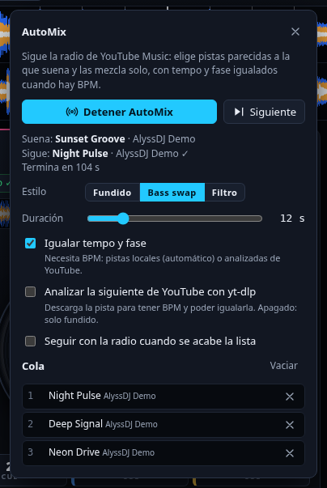
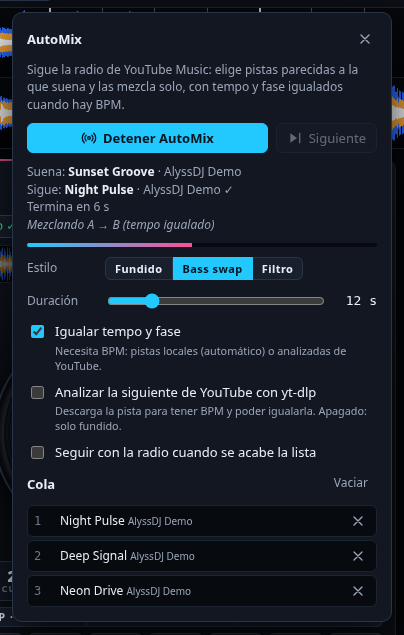

# 4. AutoMix

AutoMix es un DJ automático: elige la siguiente pista y la **mezcla solo**, con fundido, tempo y fase igualados cuando hay BPM. La cola puede salir de la **radio de YouTube Music** (pistas parecidas a la que suena) o de una lista.

## Cómo iniciarlo

- **Con lo que suena**: carga una pista, abre **AutoMix** (barra superior) y pulsa **Iniciar AutoMix**.
- **Desde una pista**: botón **Radio** en su fila de la librería.
- **Desde una lista**: **AutoMix de esta lista** (arriba a la derecha de la librería) mezcla la lista seguida. Al acabarse sigue con la radio, salvo que lo desactives.
- **A tu medida**: añade pistas con **+**; van a la cola en ese orden.

## Qué hace

1. La pista que suena está en un deck; **la siguiente se precarga en el otro**.
2. Cuando falta `duración + 1 s` para el final, empieza la transición.
3. Si ambas pistas tienen BPM, la entrante **se iguala** (también a doble o mitad de tempo, hasta ±12 %) y se **alinea la fase**; durante la mezcla se corrige con pequeños empujones.
4. Al terminar, el deck anterior se pausa y el tempo de la nueva **vuelve poco a poco a su valor natural**.

Durante la transición se ve el crossfader moverse, los graves cambiar de manos y una barra de progreso en el panel:

## Opciones

| Opción | Efecto |
|---|---|
| **Estilo: Fundido** | Solo el crossfader |
| **Estilo: Bass swap** | La entrante entra sin graves; a mitad de la mezcla se intercambian los graves |
| **Estilo: Filtro** | La saliente se cierra con un filtro y la entrante se abre |
| **Duración** | De 4 a 48 s |
| **Igualar tempo y fase** | Necesita BPM en las dos pistas |
| **Analizar la siguiente con yt-dlp** | Para pistas de YouTube: baja y analiza la siguiente (así puede igualarla). Apagado: esas pistas hacen fundido simple |
| **Seguir con la radio** | Cuando se acaba la lista |

- **Siguiente** fuerza la mezcla ya (con una transición corta).
- **Cola**: quita pistas con ✕ o vacíala.
- Si **pausas** el deck a mano o cargas otra pista, AutoMix espera; **Detener AutoMix** lo apaga.

## Consejos

- Las **pistas locales** siempre tienen BPM, así que se igualan sin hacer nada.
- Con pistas de YouTube, activa *Analizar la siguiente* si quieres mezclas a tempo; tarda unos segundos por pista (se precarga mientras suena la actual).
- Si la radio no devuelve nada (YouTube Music aún cargando o sin red), el panel lo avisa y reintenta a los pocos segundos.
