# 4. AutoMix

AutoMix es un DJ automático: elige la siguiente pista y la **mezcla solo**, con fundido, tempo y fase igualados. La cola puede salir de la **radio de YouTube Music** (pistas parecidas a la que suena) o de una lista, y tú la controlas **al vuelo** desde su propia vista.

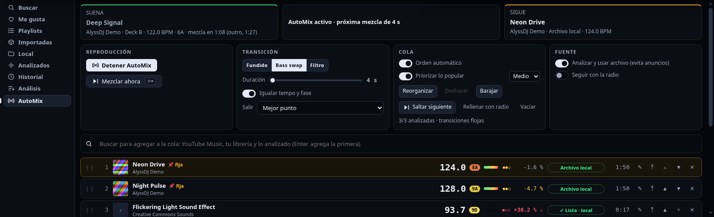

## Cómo iniciarlo

- **Con lo que suena**: carga una pista, abre la fuente **AutoMix** (en el panel de la librería, o el botón de la barra superior) y pulsa **Iniciar AutoMix**.
- **Desde una pista**: botón **Radio** en su fila de la librería.
- **Desde una lista**: **AutoMix de esta lista** mezcla la lista seguida. Al acabarse sigue con la radio, salvo que lo desactives.
- **A tu medida**: añade pistas con **+**, o **arrástralas desde la librería** a la posición que quieras dentro de la cola.

## La vista

Al abrir la fuente **AutoMix** de la librería la app pasa a la vista **Librería** (decks compactos) y al salir vuelve a la anterior. Si prefieres solo mirar y controlar, la vista **Automix** (Alt+3) muestra la portada grande, la siguiente pista, la barra de la transición, Iniciar / Mezclar ahora, el estilo y la duración; **Ver cola** abre la cola completa.

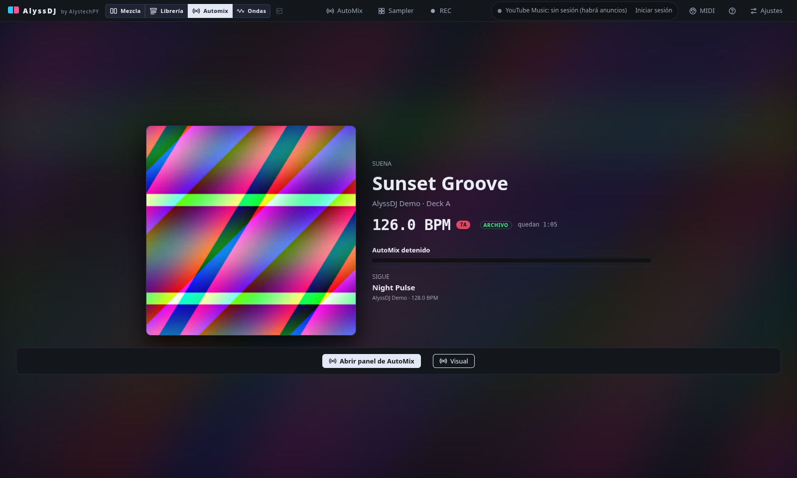

### El visual

Detrás de la portada, la vista **Automix** dibuja unos **anillos que laten con el beat** del deck que suena: salen de la portada y se expanden una vez por beat, con un pulso más marcado en el primer tiempo de cada compás, y la portada «late» un poco (hasta un 1,5 %). Son cian para el deck A y rosa para el B; durante una transición se ven los dos y el color pasa de uno al otro con el crossfader.

- Es **igual para pistas locales, guardadas y de stream**: solo usa el nivel de audio, el BPM y la posición del deck. Sin BPM, un anillo respira con el nivel; en pausa, los anillos quedan quietos y tenues.
- El botón **Visual** (junto a *Ver cola*) lo enciende o apaga y se recuerda entre sesiones. Viene activado.
- Dibuja a 30 cuadros por segundo como máximo y **solo mientras la vista Automix está visible** y la ventana no está oculta; fuera de eso no gasta procesador. No cambia el audio.
- Si tu sistema tiene activado el **movimiento reducido**, el visual se queda estático.
- No es vídeo (se retiró en la v0.5.0 porque no funcionaba bien) ni un analizador de espectro: los decks de stream no ofrecen espectro.

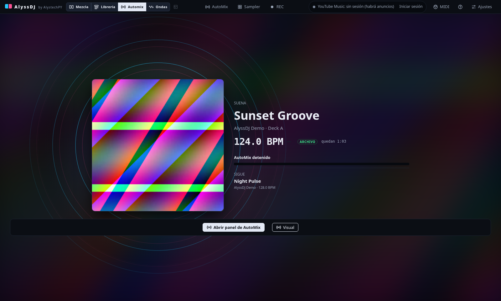

Arriba, tres tarjetas: **SUENA** (con lo que falta), el estado de la mezcla con su barra de progreso y **SIGUE**. Debajo, los controles y la **cola completa**.

| Control | Qué hace |
|---|---|
| **Iniciar / Detener AutoMix** | Enciende o apaga el DJ automático |
| **Mezclar ahora** (**Mayús + →**) | Pasa ya a la siguiente pista **lista**, con una transición corta. Úsalo cuando el cambio sea bueno. Si aún no hay ninguna lista, se mezclará en cuanto la haya |
| **Estilo** | *Auto* (por defecto, elige la receta en cada mezcla), *Fundido*, *Bass swap*, *Filtro*, *Eco y corte* o *Corte* (en la caída). Ver «Recetas de DJ» |
| **Duración** | De 4 a 48 s |
| **Analizar y usar archivo** | Ver abajo. Activado por defecto |
| **Igualar tempo y fase** | Necesita BPM en las dos pistas |
| **Seguir con la radio** / **Rellenar con radio** | Completa la cola con pistas parecidas, ahora o cuando se acabe |

### Cambios al vuelo

Cada pista de la cola tiene: **⤒** (poner a continuación), **▲ ▼** (subir o bajar), **✕** (quitar), y se puede **arrastrar** para reordenar. Funciona **también durante una transición** sin interrumpir lo que suena: al terminar, se retira la pista que entró y se conserva lo que cambiaste.

## Siempre analizar y usar el archivo (sin anuncios)

Con **Analizar y usar archivo** activado, las próximas pistas de YouTube se **descargan sin sesión, se analizan y se guardan** en tu librería local con antelación (las 3 siguientes), y cuando están listas el deck **abre el archivo, no el stream**. Así no hay anuncios y hay BPM para igualar el tempo y la fase.

Cada pista de la cola muestra su estado: **En cola · Bajando 42 % · Analizando · ✓ Lista · local · Falló**.

- La siguiente **solo se precarga cuando está lista**.
- Si al llegar el momento de mezclar la siguiente no está lista, AutoMix **espera hasta 20 s**; si sigue sin estarlo, **salta a la primera que sí lo esté**. Si ninguna lo está, mezcla la primera por streaming con un fundido simple y lo avisa.
- Una pista que falla (por ejemplo, no disponible) pasa al final de la cola y no la bloquea.
- Las pistas locales siempre están listas.

Apagando esa opción vuelve el comportamiento anterior (stream con fundido, y tempo solo si analizaste la pista).

## Mezclar en el mejor punto, no siempre al final

Al analizar una pista (o al cargarla desde tu disco), AlyssDJ también calcula su **estructura**: la divide en **frases de 16 beats** alineadas a la rejilla, mide la energía de cada una y detecta **dónde acaba la intro**, **dónde empieza el outro** y las **roturas** (una frase fuerte seguida de una floja).

Con el selector **Salir** en **Mejor punto** (el valor por defecto):

- La pista que suena **sale en su mejor punto**: el comienzo del outro, o una rotura, siempre en un límite de frase. Si una pista tiene un outro largo, no esperas a que acabe.
- La siguiente **entra en su punto de entrada** (el primer beat con música), no en un segundo cualquiera.
- La mezcla dura **compases enteros** (múltiplos de 4 beats) cercanos a la **Duración** que elegiste, y se recorta si queda poco tramo.
- En la vista, la tarjeta **SUENA** muestra cuándo toca (`mezcla en 1:12 (outro, 1:40)`), y en la vista general de cada deck se marcan la **entrada** (verde), la **región de outro** (ámbar) y las **salidas candidatas**.
- Sin estructura (pista sin analizar o con un análisis antiguo) vuelve a mezclar al final; los análisis antiguos se **recalculan solos con el archivo que ya está en tu disco**, sin descargar nada. Con **Final de la pista** mezcla siempre al final.

### Elegir cuándo sale la pista que suena

El selector **Salir** (grupo Transición) ofrece cuatro modos, inspirados en los modos de transición de los DJ automáticos como el AutoDJ de Mixxx:

| Modo | Cuándo sale | Cuánto dura la mezcla |
|---|---|---|
| **Mejor punto** (por defecto) | En el mejor punto del análisis: el comienzo del outro o una rotura | La **Duración** elegida |
| **Outro y intro** | Al empezar el outro | El **menor** entre lo que queda de outro de la pista que suena y el intro de la que entra (desde su punto de entrada hasta que acaba el intro). Si solo se conoce uno, ese; si ninguno, la duración elegida. Entre 4 y 48 s, y sin pasar del outro de la propia entrante |
| **Inicio del outro** | Al empezar el outro | La **Duración** elegida |
| **Final de la pista** | Casi al final | La **Duración** elegida |

- Los **puntos de salida que editaste** a mano siguen mandando en cualquier modo.
- Si una pista no tiene outro marcado (sin análisis o sin BPM), sale como en *Final de la pista* y el estado lo dice («sin outro marcado: sale al final»).
- Con un plan listo, el estado muestra cuánto durará la próxima mezcla («próxima mezcla de 12 s»).
- Quien tenía guardado «Mezclar en puntos óptimos» lo conserva: activado equivale a *Mejor punto* y apagado a *Final de la pista*.

## Efectos de DJ en AutoMix

El selector **Efectos** (grupo Transición) decide si AutoMix usa la cadena de efectos de los decks, como haría un DJ:

| Nivel | Qué hace |
|---|---|
| **Apagado** | Nada: solo crossfader, graves o filtro, como antes |
| **Sutil** (por defecto) | En cada transición: **eco de salida** (en el último cuarto de la mezcla sube un eco sincronizado en la pista que sale; su cola suena hasta 4 s y se apaga) y **reverb de rotura** (si la pista que sale tiene una rotura dentro de la transición y el estilo no es *Filtro*) |
| **Marcado** | Además, mientras suena la pista: un **riser** (un phaser que sube durante una subida y se corta de golpe en la caída) y una **reverb** en cada rotura |

Los momentos salen del análisis que ya existe: de la energía de cada frase se deducen las **subidas** (varias frases seguidas creciendo), las **caídas** (un salto de energía que destaca) y las **roturas** (la energía cae y se queda baja). No hace falta volver a analizar nada. Una pista sin BPM o con muy pocas frases no tiene cues y se mezcla como siempre.

Reglas de seguridad:

- AutoMix **solo usa ranuras de efecto apagadas**; nunca toca una que tengas encendida. Si no hay ninguna libre, omite el efecto y lo dice en la nota («sin ranura libre para eco de salida»).
- Si **tocas a mano** una ranura que AutoMix está usando, la suelta y no vuelve a moverla en ese movimiento.
- Al terminar un movimiento, al detener AutoMix o al saltar de pista, las ranuras vuelven a como estaban (tipo, cantidad, P y apagadas). No quedan efectos colgados.
- Un solo movimiento a la vez sobre la pista que suena, con al menos una frase entre uno y otro, y ninguno en los 8 s previos a la salida. Si mueves la aguja a mano, se suelta el efecto.
- La nota de la mezcla y la vista **Automix** muestran el efecto en curso («Efecto: eco de salida»).

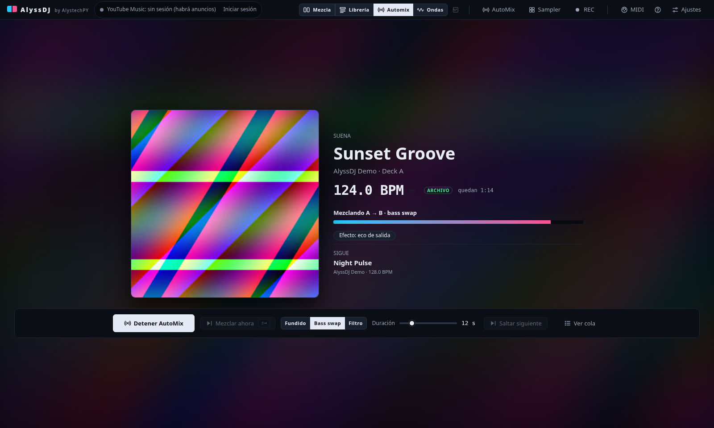

## El BPM siempre cuenta

Con **Ordenar por compatibilidad** (activado), AutoMix pone **primero la pista que mejor encaja** con la que suena entre las que están listas:

| Criterio | Cómo puntúa |
|---|---|
| **BPM** | Diferencia relativa de tempo (también a doble o mitad). Cuanto menor, mejor |
| **Tonalidad** | Misma clave mejor que vecina o relativa (rueda Camelot), y esas mejor que una que choca |
| **Energía** | Que no haya un salto grande entre la energía donde sale una y donde entra la otra |

Cada pista de la cola muestra su **BPM**, **tonalidad**, **energía** y la **diferencia de BPM** con lo que suena (`+1.6 %`). Si reordenas a mano (**⤒**, arrastrar, subir/bajar), el orden que dejas queda **📌 fijo** y no se toca; solo lo que se añada después se ordena solo.

### Sin cambios bruscos

- Si una candidata supera un **8 %** de diferencia de BPM, se prefiere otra lista. Si no hay otra, la mezcla es **más larga, con filtro y sin forzar el tempo**, y se avisa (`salto de BPM −17 %`, en rojo con ⚠).
- Al igualar el tempo, el ajuste está limitado a **±8 %**, y tras la mezcla el tempo natural de la pista **vuelve poco a poco** (unos 14 s), sin saltos.

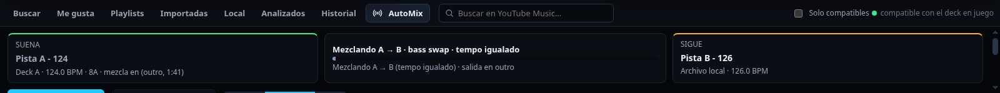

## Qué hace la mezcla

1. La pista que suena está en un deck; **la siguiente se precarga en el otro**.
2. Cuando la pista que suena llega a su **punto de salida**, empieza la transición (o antes, si pulsas **Mezclar ahora**).
3. Si ambas pistas tienen BPM, la entrante **se iguala** (también a doble o mitad de tempo, hasta ±12 %) y se **alinea la fase**; durante la mezcla se corrige con pequeños empujones.
4. Al terminar, el deck anterior se pausa y el tempo de la nueva **vuelve poco a poco a su valor natural**.

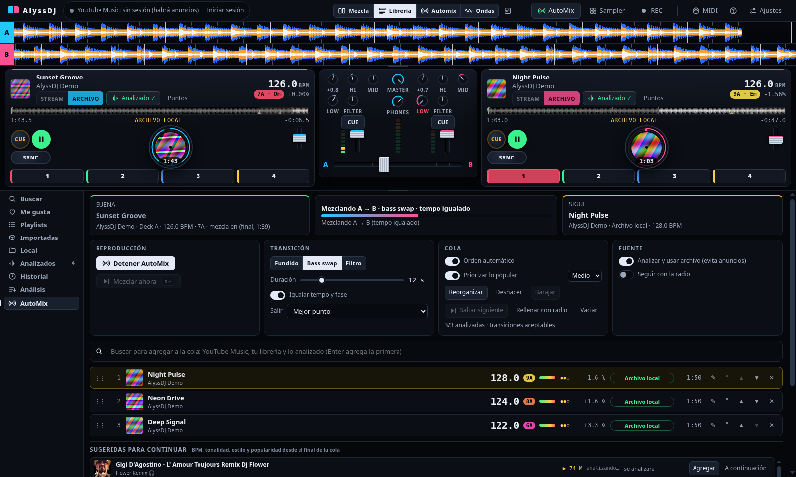

Durante la transición la vista muestra de qué deck a cuál se mezcla, el estilo, si el tempo está igualado y el progreso:

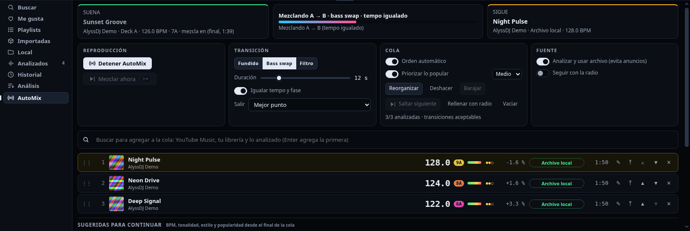

## Cola analizada y ordenada

- **Toda la cola se analiza sola** en cuanto se añade (de a 2 a la vez y en orden); cada fila muestra su estado, BPM, tonalidad y la **calidad de la transición** desde la anterior (●●● muy buena, ●●○ aceptable, ●○○ floja).
- Con **Orden automático**, las pistas analizadas se ordenan como una **cadena**: parte de lo que suena y busca el BPM más gradual, tonalidades compatibles y energía continua en toda la cola, no solo la siguiente. Lo que fijas a mano 📌 y la pista que ya se está preparando no se mueven.
- **Reorganizar ahora** ordena aunque el interruptor esté apagado; **Deshacer** vuelve al orden anterior.
- Mientras AutoMix está activo, los **decks se compactan** solos para dejar espacio a la lista (plato pequeño, bancos de funciones ocultos, mezclador reducido) y vuelven a su tamaño al detenerlo.

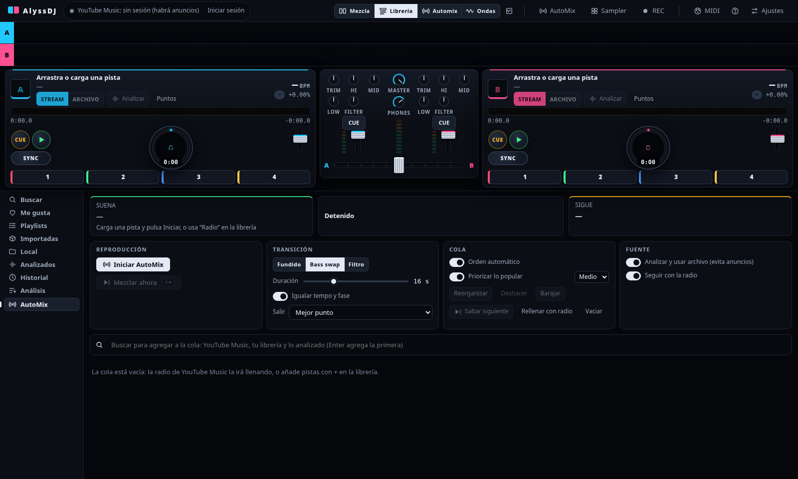

## Controles por grupos

Los controles de AutoMix están agrupados por función, con título:

- **Reproducción:** iniciar o detener AutoMix y **Mezclar ahora** (**⇧→**).
- **Transición:** estilo (fundido, bass swap, filtro), duración, igualar tempo y fase, **Salir** (cuándo sale la pista que suena) y **Efectos** (apagado, sutil o marcado).
- **Cola:** orden automático, **Priorizar lo popular** (con su peso), **Reorganizar**, **Barajar**, **Deshacer**, **Saltar siguiente**, **Rellenar con radio** y **Vaciar**.
  - **Barajar** ordena al azar lo que no está fijado (no mueve lo fijado a mano ni la pista que ya se está preparando), apaga «Orden automático» para que no rehaga el orden y se puede **Deshacer**.
  - **Saltar siguiente** quita de la cola la pista que sigue; la mezcla irá a la que venía después. También está en la vista **Automix**.
- **Fuente:** analizar y usar el archivo (evita anuncios) y seguir con la radio.

## Buscar y agregar desde la propia vista

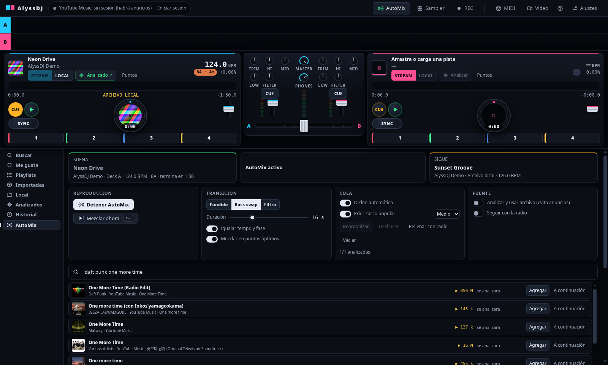

- Escribe en el buscador de la vista de AutoMix: salen resultados de tu **librería** y de **YouTube Music**, con sus **reproducciones** («856 M»). **Agregar** (o Enter, que agrega la primera) y **A continuación** (para ponerla la siguiente). No repite lo que ya está en la cola o suena.
- Si la pista ya está analizada, la fila dice **→ posición N** y se inserta en el hueco que menos empeora la cadena de BPM, tonalidad y energía; el aviso te dice dónde quedó. Si no, entra al final, se **analiza** y se **mueve sola** a su mejor lugar («movida de 5 a 2»); el resto de la cola se reordena alrededor.

## Qué iría a continuación

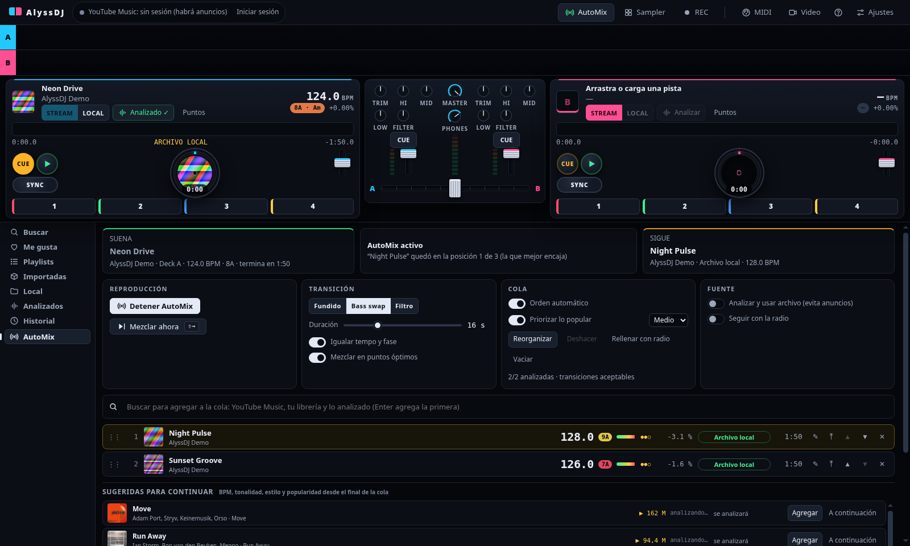

Bajo la cola aparecen hasta 6 **sugeridas**: la radio de YouTube Music y lo ya analizado de tu librería, ordenadas por cómo mezclan desde la **última pista de la cola**. Las que aún no tienen BPM se analizan en segundo plano (de a una, sin guardar el audio) y suben o bajan al llegar su análisis. Cada una se agrega con un clic.

**Priorizar lo popular** (Poco / Medio / Mucho) hace que, entre pistas que mezclan igual de bien, gane la más reproducida (las reproducciones salen de la búsqueda o de la ficha de la pista, con caché de 30 días). **Nunca** pone por delante una popular que no encaja (salto de BPM mayor al 8 % o tonalidad incompatible). El estilo también cuenta: la misma radio de la semilla, el mismo artista y un año cercano suman. Vale igual para llenar la cola con la radio.

## Editar los puntos de mezcla

Con **✎** en una fila de la cola, o **Puntos** en un deck, se abre el editor de la pista (debe estar analizada):

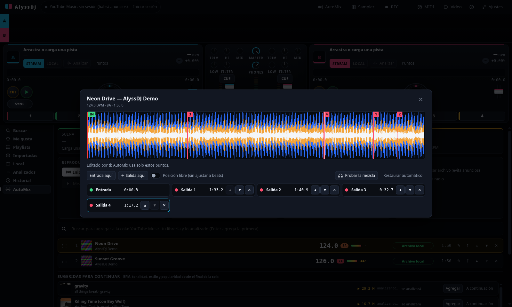

- Las líneas discontinuas son los puntos **automáticos** (entrada en verde, salidas en rojo con su puntuación). Al mover, añadir o borrar uno, pasan a ser **los tuyos** y AutoMix usa solo esos.
- **Doble clic** (o clic derecho) en la onda añade una salida; **arrastra** una línea para moverla (se ajusta a beats; **Mayús** a frases de 16 beats; o marca «Posición libre»). **Supr** borra la seleccionada. Hasta **6 salidas** y una entrada.
- El **orden** de la lista es tu preferencia: AutoMix sale por la primera que aún esté por delante.
- **Probar la mezcla** reproduce el final de la pista y la entrada de la siguiente (por auriculares si hay salida cue); necesita ambas guardadas como archivo local. **Restaurar automático** descarta tus cambios. Lo editado se conserva aunque la pista se reanalice.

## Consejos

- Si pausas el deck a mano o cargas otra pista, AutoMix espera; **Detener AutoMix** lo apaga.
- Para una mezcla **más rápida**, baja la duración; para pasar a otra pista ya, **Mezclar ahora** (Mayús + →): no corta a mitad de un compás, sino que busca la **salida más cercana** (un punto de la pista o un límite de frase de 8 beats, a lo sumo 12 s después), entra en la siguiente por su punto de entrada con el tempo igualado y dura compases enteros. La vista cuenta atrás («Mezclando en 3,2 s · salida en frase»); otra pulsación la **cancela**. Sin BPM en alguna de las dos hace un fundido corto de inmediato.
- Si la radio no devuelve nada (YouTube Music aún cargando o sin red), la vista lo avisa y reintenta a los pocos segundos.

## Recetas de DJ

Cada estilo es una receta: una lista de gestos (EQ, filtro, crossfader y efectos) colocados sobre la **rejilla** de la pista que sale, con los cambios grandes en el inicio de compás o de frase. En la vista Automix, una tira bajo la barra de progreso muestra los gestos de la mezcla planificada o en curso, el activo resaltado y una marca del instante actual.

| Receta | Qué hace |
|---|---|
| **Bass swap** | La entrante entra con el grave cortado; medios y agudos se mezclan y el grave cambia de pista en un inicio de frase (con un compás limpio antes y después) |
| **Filtro** | La saliente cierra el paso alto en sus últimos 8 o 16 pulsos; la entrante se abre desde la entrada hasta la frase donde toma el grave |
| **Eco y corte** | Eco a 1/2 o 3/4 de pulso en el primer tiempo del último compás y corte seco en la línea de compás; para saltos de BPM grandes, tonalidades en conflicto o pistas sin rejilla |
| **Corte** (en la caída) | Si la saliente tiene una rotura y la entrante entra fuerte, corte en el inicio de compás con cola de reverb |
| **Fundido** | Solo crossfader |

Con **Auto**, la elección sale del análisis: sin BPM, fundido; salto de BPM grande o tonalidades en conflicto, eco y corte; rotura de la saliente con la entrante fuerte, corte; BPM algo distinto (más de un 3 %) u outro o intro cortos, filtro; BPM y tonalidad compatibles con outro e intro de al menos 8 compases, bass swap. El motivo aparece en la nota de la mezcla. Con el nivel de efectos en *Apagado* solo se ejecutan los gestos de EQ y filtro.
