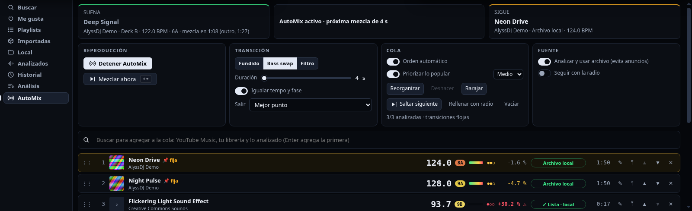
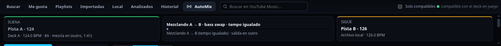
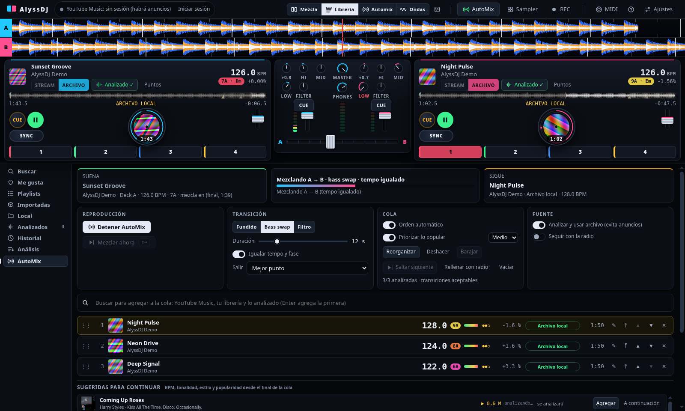
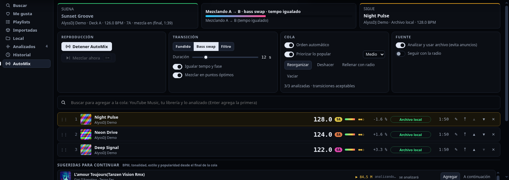
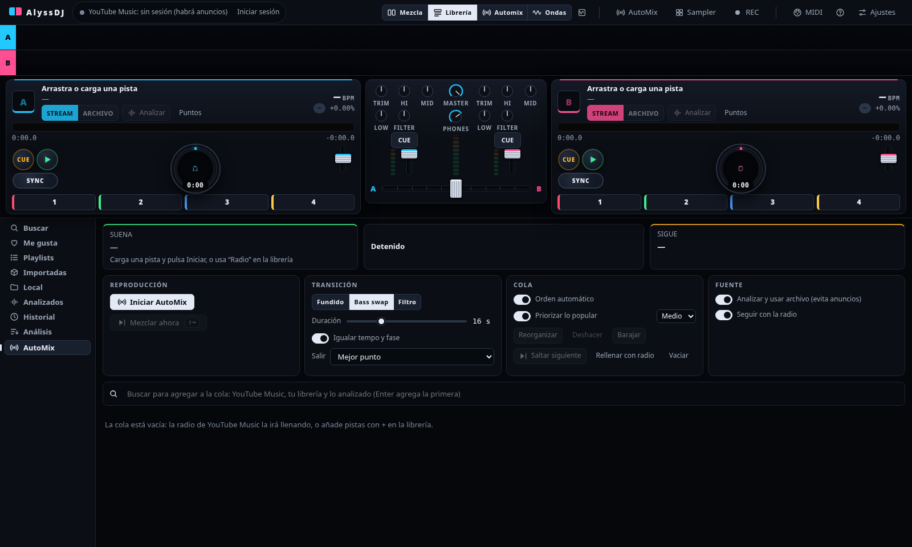
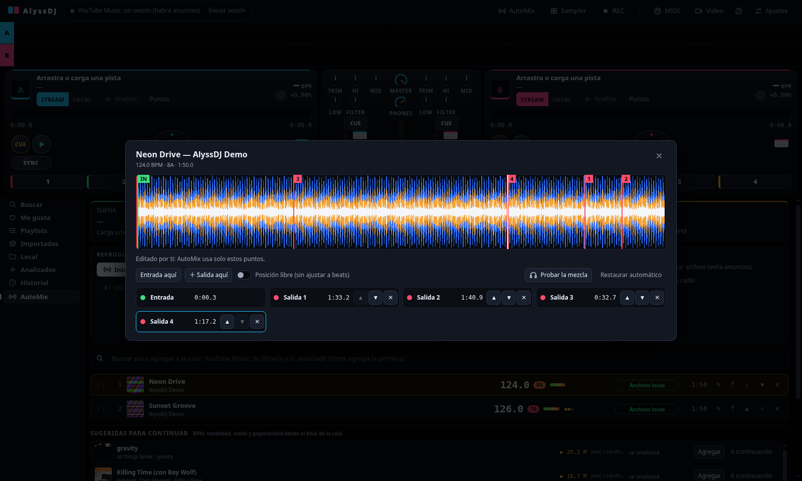

# 4. AutoMix

AutoMix es un DJ automático: elige la siguiente pista y la **mezcla solo**, con fundido, tempo y fase igualados. La cola puede salir de la **radio de YouTube Music** (pistas parecidas a la que suena) o de una lista, y tú la controlas **al vuelo** desde su propia vista.

## Cómo iniciarlo

- **Con lo que suena**: carga una pista, abre la pestaña **AutoMix** (en la librería, o el botón de la barra superior) y pulsa **Iniciar AutoMix**.
- **Desde una pista**: botón **Radio** en su fila de la librería.
- **Desde una lista**: **AutoMix de esta lista** mezcla la lista seguida. Al acabarse sigue con la radio, salvo que lo desactives.
- **A tu medida**: añade pistas con **+**, o **arrástralas desde la librería** a la posición que quieras dentro de la cola.

## La vista

Arriba, tres tarjetas: **SUENA** (con lo que falta), el estado de la mezcla con su barra de progreso y **SIGUE**. Debajo, los controles y la **cola completa**.

| Control | Qué hace |
|---|---|
| **Iniciar / Detener AutoMix** | Enciende o apaga el DJ automático |
| **Mezclar ahora** (**Mayús + →**) | Pasa ya a la siguiente pista **lista**, con una transición corta. Úsalo cuando el cambio sea bueno. Si aún no hay ninguna lista, se mezclará en cuanto la haya |
| **Estilo** | *Fundido* (solo crossfader), *Bass swap* (los graves de la entrante entran a mitad) o *Filtro* (la saliente se cierra y la entrante se abre) |
| **Duración** | De 4 a 48 s |
| **Analizar y usar archivo** | Ver abajo. Activado por defecto |
| **Igualar tempo y fase** | Necesita BPM en las dos pistas |
| **Seguir con la radio** / **Rellenar con radio** | Completa la cola con pistas parecidas, ahora o cuando se acabe |

### Cambios al vuelo

Cada pista de la cola tiene: **⤒** (poner a continuación), **▲ ▼** (subir o bajar), **✕** (quitar), y se puede **arrastrar** para reordenar. Funciona **también durante una transición** sin interrumpir lo que suena: al terminar, se retira la pista que entró y se conserva lo que cambiaste.

## Siempre analizar y usar el archivo (sin anuncios)

Con **Analizar y usar archivo** activado, las próximas pistas de YouTube se **descargan sin sesión, se analizan y se guardan** en tu librería local con antelación (las 3 siguientes), y cuando están listas el deck **abre el archivo, no el stream**. Así no hay anuncios y hay BPM para igualar el tempo y la fase.

Cada pista de la cola muestra su estado: **En cola · Bajando 42 % · Analizando · ✓ Lista · local · Falló**.

- La siguiente **solo se precarga cuando está lista**.
- Si al llegar el momento de mezclar la siguiente no está lista, AutoMix **espera hasta 20 s**; si sigue sin estarlo, **salta a la primera que sí lo esté**. Si ninguna lo está, mezcla la primera por streaming con un fundido simple y lo avisa.
- Una pista que falla (por ejemplo, no disponible) pasa al final de la cola y no la bloquea.
- Las pistas locales siempre están listas.

Apagando esa opción vuelve el comportamiento anterior (stream con fundido, y tempo solo si analizaste la pista).

## Mezclar en el mejor punto, no siempre al final

Al analizar una pista (o al cargarla desde tu disco), AlyssDJ también calcula su **estructura**: la divide en **frases de 16 beats** alineadas a la rejilla, mide la energía de cada una y detecta **dónde acaba la intro**, **dónde empieza el outro** y las **roturas** (una frase fuerte seguida de una floja).

Con **Mezclar en puntos óptimos** (activado por defecto):

- La pista que suena **sale en su mejor punto**: el comienzo del outro, o una rotura, siempre en un límite de frase. Si una pista tiene un outro largo, no esperas a que acabe.
- La siguiente **entra en su punto de entrada** (el primer beat con música), no en un segundo cualquiera.
- La mezcla dura **compases enteros** (múltiplos de 4 beats) cercanos a la **Duración** que elegiste, y se recorta si queda poco tramo.
- En la vista, la tarjeta **SUENA** muestra cuándo toca (`mezcla en 1:12 (outro, 1:40)`), y en la vista general de cada deck se marcan la **entrada** (verde), la **región de outro** (ámbar) y las **salidas candidatas**.
- Sin estructura (pista sin analizar o con un análisis antiguo) vuelve a mezclar al final; los análisis antiguos se **recalculan solos con el archivo que ya está en tu disco**, sin descargar nada. Apagando la opción, mezcla siempre al final.

## El BPM siempre cuenta

Con **Ordenar por compatibilidad** (activado), AutoMix pone **primero la pista que mejor encaja** con la que suena entre las que están listas:

| Criterio | Cómo puntúa |
|---|---|
| **BPM** | Diferencia relativa de tempo (también a doble o mitad). Cuanto menor, mejor |
| **Tonalidad** | Misma clave mejor que vecina o relativa (rueda Camelot), y esas mejor que una que choca |
| **Energía** | Que no haya un salto grande entre la energía donde sale una y donde entra la otra |

Cada pista de la cola muestra su **BPM**, **tonalidad**, **energía** y la **diferencia de BPM** con lo que suena (`+1.6 %`). Si reordenas a mano (**⤒**, arrastrar, subir/bajar), el orden que dejas queda **📌 fijo** y no se toca; solo lo que se añada después se ordena solo.

### Sin cambios bruscos

- Si una candidata supera un **8 %** de diferencia de BPM, se prefiere otra lista. Si no hay otra, la mezcla es **más larga, con filtro y sin forzar el tempo**, y se avisa (`salto de BPM −17 %`, en rojo con ⚠).
- Al igualar el tempo, el ajuste está limitado a **±8 %**, y tras la mezcla el tempo natural de la pista **vuelve poco a poco** (unos 14 s), sin saltos.

## Qué hace la mezcla

1. La pista que suena está en un deck; **la siguiente se precarga en el otro**.
2. Cuando la pista que suena llega a su **punto de salida**, empieza la transición (o antes, si pulsas **Mezclar ahora**).
3. Si ambas pistas tienen BPM, la entrante **se iguala** (también a doble o mitad de tempo, hasta ±12 %) y se **alinea la fase**; durante la mezcla se corrige con pequeños empujones.
4. Al terminar, el deck anterior se pausa y el tempo de la nueva **vuelve poco a poco a su valor natural**.

Durante la transición la vista muestra de qué deck a cuál se mezcla, el estilo, si el tempo está igualado y el progreso:

## Cola analizada y ordenada

- **Toda la cola se analiza sola** en cuanto se añade (de a 2 a la vez y en orden); cada fila muestra su estado, BPM, tonalidad y la **calidad de la transición** desde la anterior (●●● muy buena, ●●○ aceptable, ●○○ floja).
- Con **Orden automático**, las pistas analizadas se ordenan como una **cadena**: parte de lo que suena y busca el BPM más gradual, tonalidades compatibles y energía continua en toda la cola, no solo la siguiente. Lo que fijas a mano 📌 y la pista que ya se está preparando no se mueven.
- **Reorganizar ahora** ordena aunque el interruptor esté apagado; **Deshacer** vuelve al orden anterior.
- Mientras AutoMix está activo, los **decks se compactan** solos para dejar espacio a la lista (plato pequeño, bancos de funciones ocultos, mezclador reducido) y vuelven a su tamaño al detenerlo.

## Editar los puntos de mezcla

Con **✎** en una fila de la cola, o **Puntos** en un deck, se abre el editor de la pista (debe estar analizada):

- Las líneas discontinuas son los puntos **automáticos** (entrada en verde, salidas en rojo con su puntuación). Al mover, añadir o borrar uno, pasan a ser **los tuyos** y AutoMix usa solo esos.
- **Doble clic** (o clic derecho) en la onda añade una salida; **arrastra** una línea para moverla (se ajusta a beats; **Mayús** a frases de 16 beats; o marca «Posición libre»). **Supr** borra la seleccionada. Hasta **6 salidas** y una entrada.
- El **orden** de la lista es tu preferencia: AutoMix sale por la primera que aún esté por delante.
- **Probar la mezcla** reproduce el final de la pista y la entrada de la siguiente (por auriculares si hay salida cue); necesita ambas guardadas como archivo local. **Restaurar automático** descarta tus cambios. Lo editado se conserva aunque la pista se reanalice.

## Consejos

- Si pausas el deck a mano o cargas otra pista, AutoMix espera; **Detener AutoMix** lo apaga.
- Para una mezcla **más rápida**, baja la duración; para pasar a otra pista ya, **Mezclar ahora**.
- Si la radio no devuelve nada (YouTube Music aún cargando o sin red), la vista lo avisa y reintenta a los pocos segundos.
