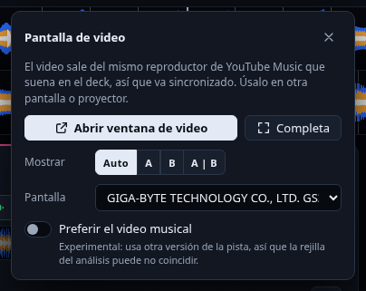

# 5. Video y segunda pantalla

## El plato no lleva video

El centro del plato muestra siempre la **portada**, que gira con la pista. El video no se reproduce ahí porque pesa demasiado: se ve en la **ventana de video** (abajo) o en la **vista de video de AutoMix**.

El doble clic en el plato, su botón de ventana y **Video** (arriba) abren la ventana de video.

## Ventana de video

Abre una ventana aparte con el video a pantalla completa, para otra pantalla o un proyector. Se abre con el botón **Video** (barra superior) o con el botón del plato (esquina inferior derecha, aparece al pasar el ratón) o **doble clic en el plato**.

| Control | Qué hace |
|---|---|
| **Abrir / cerrar ventana de video** | Muestra u oculta la ventana |
| **Completa** | Pantalla completa en la pantalla donde esté la ventana |
| **Mostrar: Auto** | Sigue al deck que está al aire (con un respiro de 0,6 s para no parpadear al cruzar) |
| **Mostrar: A · B · A \| B** | Fija un deck, o los dos lado a lado |
| **Pantalla** | Elige en qué monitor abrirla |
| **Preferir el video musical** | *Experimental*: pide a YouTube Music la versión en video de la pista. Puede durar distinto que el audio, y la rejilla del análisis podría no coincidir |

## Cómo funciona (y por qué va sincronizado)

El video es **el mismo reproductor** que suena en el deck: la ventana solo lo muestra aislado de la interfaz de YouTube Music. Por eso cerrar la ventana no corta el audio y nunca se desfasa.

## Qué muestra la ventana de video

Cada mitad de la ventana muestra solo lo que es de ese deck:

- **Pista de streaming ya cargada:** el video de YouTube Music de esa pista.
- **Pista local con video guardado:** ese video, sincronizado con el audio.
- **Deck vacío, pista sin video o aún cargando:** pantalla negra con la portada atenuada y la leyenda «Sin pista», «Sin video» o «Cargando…». Nunca se enseña la página de YouTube Music de un deck sin pista, que mostraría lo último que sonó.

## Límites

- Sin Premium, YouTube Music intercala anuncios y el deck lo indica ("anuncio").
- En **Wayland** el sistema puede ignorar la posición que pedimos a la ventana; con X11/XWayland funciona. La pantalla completa siempre va en la pantalla donde esté la ventana: arrástrala allí y pulsa **Completa**.
- **Video guardado:** al guardar una pista de YouTube que tiene **video musical de verdad** (no las de solo portada), AlyssDJ descarga también su video (sin audio, hasta 480p/720p/1080p según Ajustes, preferiblemente H.264) a una carpeta oculta de la librería. Cuando el deck suena desde el archivo, la ventana de video usa ese video, sincronizado con el audio (posición, pausa y velocidad). Se puede desactivar en Ajustes → «Guardar también el video…».
- Las pistas sin video real (y los archivos locales propios) muestran su portada.
