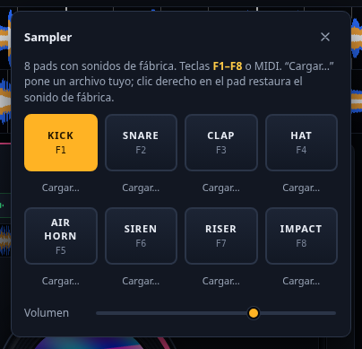
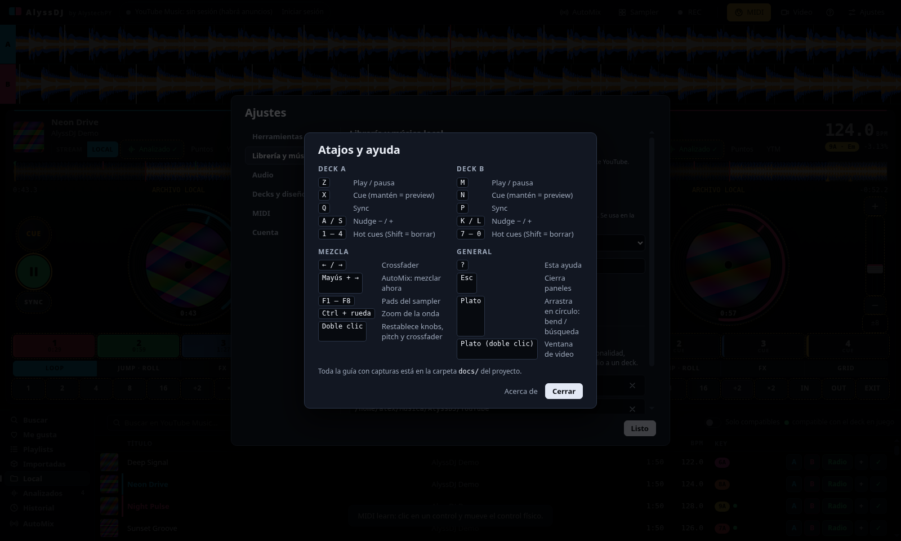
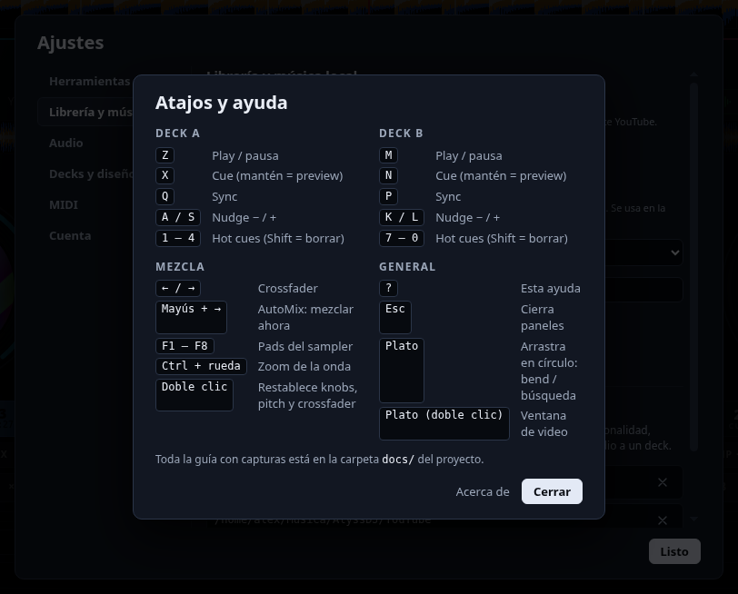
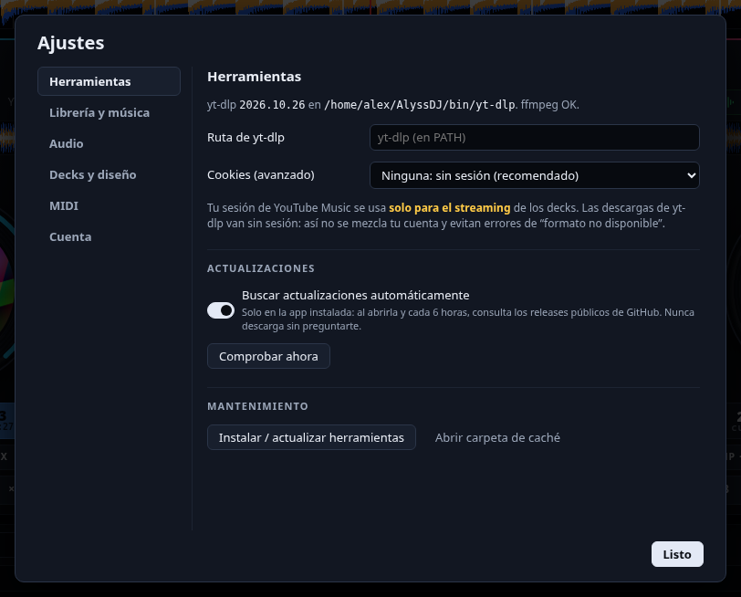
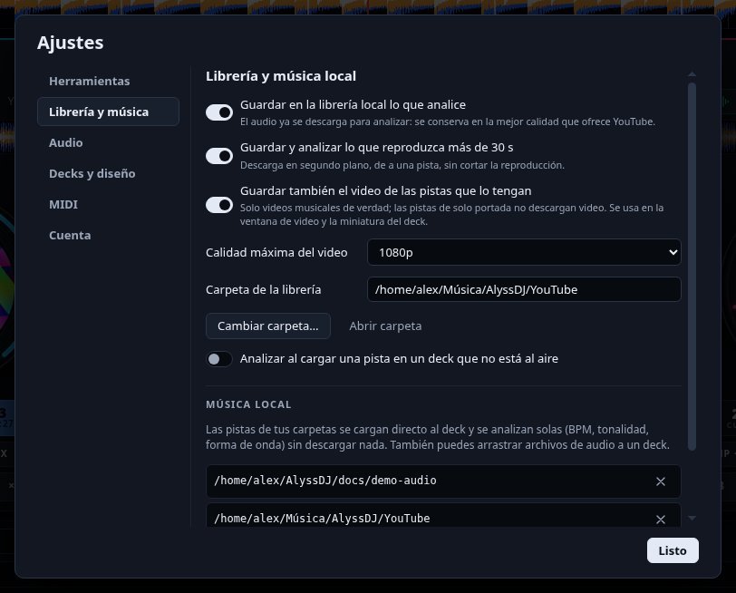

# 6. Sampler, grabación y MIDI

## Sampler

Botón **Sampler** (barra superior): 8 pads con sonidos sintetizados de fábrica (bombo, caja, clap, hi-hat, bocina, sirena, riser e impacto). No hay nada que descargar.

- **Clic** en un pad, o teclas **F1–F8**, o MIDI.
- **Cargar…** pone un archivo tuyo en ese pad (se recuerda).
- **Clic derecho** en el pad restaura el sonido de fábrica.
- El volumen es independiente y sale por el dispositivo *master*.

## Grabar la mezcla

El botón **REC** graba lo que sale por tu salida de audio a un MP3 de 256 kbps en `Música/AlyssDJ/`. Al parar, muestra el archivo en tu gestor de archivos.

- Disponible en **Linux** (PulseAudio / PipeWire). Captura el *monitor* de la salida predeterminada; puedes elegir otra en **Ajustes → Audio → Grabar desde**.
- Como los decks de YouTube suenan en procesos separados, se graba **la salida del sistema** (incluye todo lo que suene por ahí, no solo AlyssDJ).

## Controladoras MIDI

1. Pulsa **MIDI learn** (se pone amarillo).
2. Haz clic en el control de la pantalla que quieres mapear (todos se marcan con borde punteado; el elegido, con borde sólido).
3. Mueve o pulsa el control físico.
4. Repite y vuelve a pulsar **MIDI learn** para salir.

Se pueden mapear botones (play, cue, hot cues, loops, jump, roll, FX, pads del sampler…), faders y knobs (volumen, EQ, filtro, pitch, crossfader, master, phones, cantidad de FX) y el **jog** (el plato). En **Ajustes → MIDI** puedes **exportar**, **importar** o **borrar** el mapeo, y ves qué dispositivos están conectados.

## Atajos de teclado

Pulsa **?** en cualquier momento:

## Ajustes

