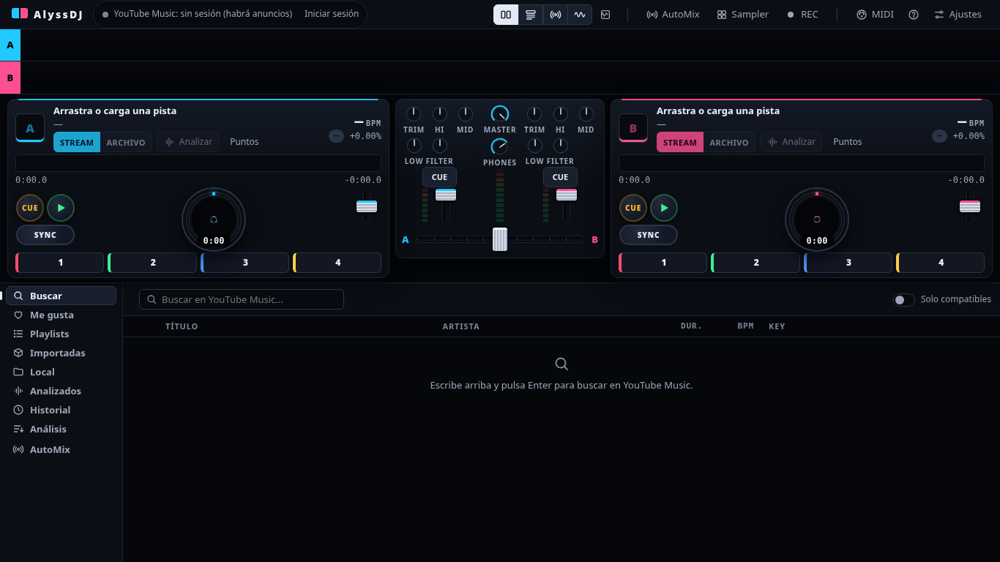

# 7. Problemas frecuentes

| Síntoma | Qué hacer |
|---|---|
| Arriba aparece "yt-dlp sin instalar" | La app lo descarga sola al abrirse (necesita internet). Si falla: **Ajustes → Instalar / actualizar herramientas** o `npm run setup` en una terminal |
| "falta ffmpeg" | Instálalo con tu gestor de paquetes (CachyOS/Arch: `sudo pacman -S ffmpeg`). Se necesita para analizar y leer archivos locales |
| "Requested format is not available" / "YouTube no entregó audio" | yt-dlp ahora va sin sesión y con un runtime de JavaScript, y reintenta con una selección más abierta. Si aun así falla, esa pista exige sesión (edad, privada) o ya no existe: sigue sonando por streaming. Pulsa **Instalar / actualizar herramientas** por si yt-dlp está desactualizado |
| **Analizar** falla | YouTube cambia a menudo y yt-dlp se rompe. Pulsa **Instalar / actualizar herramientas** (se actualiza si tiene más de 14 días). Si sigue, prueba otra fuente de cookies en Ajustes |
| Sale un anuncio en el deck | No hay sesión de Premium. **Iniciar sesión** (barra superior) |
| Google dice "No puedes acceder" al iniciar sesión | Es un bloqueo de Google a las apps. Inicia sesión en tu navegador y usa **Iniciar sesión → Importar sesión** ([guía](01-primeros-pasos.md#iniciar-sesión-youtube-music-premium)) |
| "Ese navegador no tiene la sesión de YouTube iniciada" | Abre `music.youtube.com` en ese navegador, entra con tu cuenta y vuelve a importar |
| "No se pudieron descifrar las cookies" | Chrome/Chromium las protegen con el llavero del sistema: desbloquéalo o usa Firefox |
| Un deck de YouTube se pausa al arrancar el otro | YouTube Music puede limitar dos reproducciones de la misma cuenta a la vez. Pasa uno a **LOCAL** (analiza la pista con *Conservar audio*) o usa pistas locales |
| El beatgrid no cae en los golpes | **GRID → SET GRID** sobre un bombo, o **◀ ▶** para afinar. En los streams puede haber un desfase fijo: se guarda por pista |
| SYNC / loops / beat jump dicen que falta BPM | Analiza la pista o usa **TAP** |
| Las playlists salen vacías | Hace falta la sesión iniciada. Después, **Importar mis playlists** |
| La ventana de video no se coloca en mi otra pantalla | En Wayland el sistema ignora la posición. Arrastra la ventana a esa pantalla y pulsa **Completa** |
| No suena por mis auriculares | **Ajustes → Salida de audio**: elige el dispositivo de auriculares y activa **CUE** en el canal. Revisa el knob **PHONES** |
| **REC** dice que no puede grabar | Solo Linux por ahora, y necesita `pactl` y `ffmpeg`. Elige la fuente en *Grabar desde* |
| La rueda del ratón no hace zoom | Es **Ctrl + rueda** sobre la onda. Sin Ctrl, y en pausa, la rueda busca fino |
| AutoMix no mezcla a tempo con pistas de YouTube | La pista debe estar **✓ Lista · local** en la cola (descargada, analizada y guardada). Con *Analizar y usar archivo* activado se hace sola; si una **Falló**, quítala o ponla al final |
| Quiero ver los errores | Arranca con `YTDJ_DEVTOOLS=1 npm start` |

## La interfaz se ve apretada o muy pequeña

El diseño se adapta solo al tamaño de la ventana: **compacto** (menos de 1280 de ancho o 780 de alto), **normal** y **amplio** (1920 o más, escala la interfaz). Puedes forzar uno en Ajustes → «Diseño de la interfaz».

