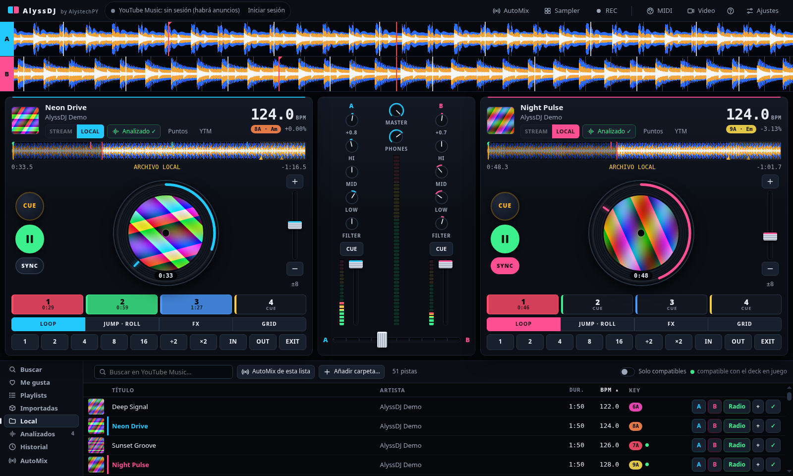

# Guías de AlyssDJ

*Un software de AlystechPY, por Alejandro Ramírez.*



| Guía | Qué cubre |
|---|---|
| [0. Instalación](00-instalacion.md) | Windows, macOS y Linux, con lo que está verificado y lo que no |
| [1. Primeros pasos](01-primeros-pasos.md) | Instalar, iniciar sesión, cargar música y mezclar tu primera transición |
| [2. Decks y mezclador](02-decks-y-mezclador.md) | Plato, cue, hot cues, loops, beat jump, roll, sync, rejilla, EQ y efectos |
| [3. Librería y playlists](03-libreria-y-playlists.md) | Buscar, música local, importar playlists, historial, orden y pistas compatibles |
| [4. AutoMix](04-automix.md) | DJ automático con la radio de YouTube Music: vista con cola editable, mezclar ahora y modo local |
| [6. Sampler, grabación y MIDI](06-sampler-grabacion-midi.md) | Pads, grabar la mezcla, controladoras y atajos |
| [7. Problemas frecuentes](07-problemas-frecuentes.md) | Qué hacer cuando algo no funciona |
| [Comparativa](COMPARATIVA.md) | Qué tienen Rekordbox, djay y Mixxx, qué añadimos y qué falta |

Las capturas se generan con audio de demostración (`docs/demo-audio`) y todo en silencio. Para regenerarlas:

```bash
node scripts/make-demo-audio.js docs/demo-audio
YTDJ_SELFTEST=1 YTDJ_SELFTEST_MODULE=$PWD/scripts/docs-screenshots.js YTDJ_USERDATA=/tmp/alyss-docs \
YTDJ_DOCS_MUSIC=$PWD/docs/demo-audio YTDJ_SELFTEST_OUT=$PWD/docs/img npx electron .
```
