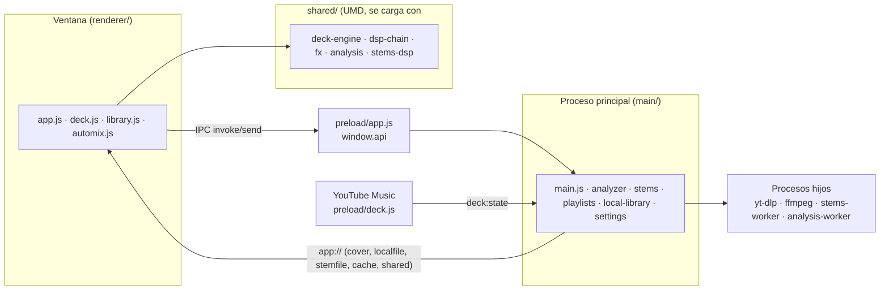

# Arquitectura de AlyssDJ

Mapa de cómo está hecha la app: qué módulo hace qué, qué depende de qué, por dónde pasan los datos y qué pruebas lo cubren. Está pensado para encontrar el sitio de un cambio sin leer todo el código.

Los documentos 01, 02, 03, 05 y 06 se **generan** desde el código y el registro [modulos.json](modulos.json) (`node scripts/arquitectura-gen.js`); las pruebas de `scripts/test-arquitectura.js` fallan si algo diverge. Lo que decide una persona (responsabilidad, dominio, «debería vivir en», notas) se edita en el registro y se conserva al regenerar. Los documentos 04 y 07 y este índice se escriben a mano.

| Documento | Contenido |
|---|---|
| [01 · Proceso principal](01-main.md) | Cada módulo de `main/`: qué hace, qué exporta, de quién depende, quién lo usa |
| [02 · Compartido y preload](02-shared-y-preload.md) | `shared/` (audio, análisis, efectos, stems) y el puente `preload/` |
| [03 · Interfaz](03-renderer.md) | Cada módulo de `renderer/` |
| [04 · Vistas y componentes](04-vistas-y-componentes.md) | Las cuatro vistas, el deck, el mezclador, la librería, AutoMix, ajustes y diálogos: estructura, IDs, estado y eventos |
| [05 · IPC y persistencia](05-ipc-y-persistencia.md) | Cada canal IPC con su manejador y llamador, rutas `app://` y qué se guarda y dónde |
| [06 · Matriz de QA](06-qa.md) | Cada módulo frente a sus pruebas, con los huecos marcados |
| [07 · Deuda](07-deuda.md) | Desviaciones priorizadas y el cambio SDD que las resolvería |

## Capas



- La interfaz **nunca** toca el disco ni la red: pide todo por `window.api` ([preload/app.js](../../preload/app.js)), que traduce cada función a un canal IPC.
- `shared/` es el único código que usan a la vez la interfaz y las pruebas en Node (módulos UMD).
- El audio **no pasa por un bus maestro**: cada deck aplica su propio `f² · crossfader · volumen maestro` (véase [02](02-shared-y-preload.md)).
- `app://` sirve la interfaz y los archivos locales (`cover`, `localfile`, `stemfile`, `cache`, `shared`) sin abrir `file://`.

## Cómo se mantiene

```bash
node scripts/arquitectura-gen.js      # regenera registro y documentos tras añadir o mover un módulo
node scripts/test-arquitectura.js     # registry, ipc y docs
xvfb-run -a node scripts/visual-check.js   # comparación visual con las referencias
```

Un módulo nuevo en `main/`, `shared/`, `preload/` o `renderer/` hace fallar `registry` hasta regenerar; un canal IPC nuevo hace fallar `ipc` hasta regenerar. Después de regenerar, completa a mano en `modulos.json` la `responsabilidad` y el `dominio` si el archivo no tiene comentario de cabecera.
